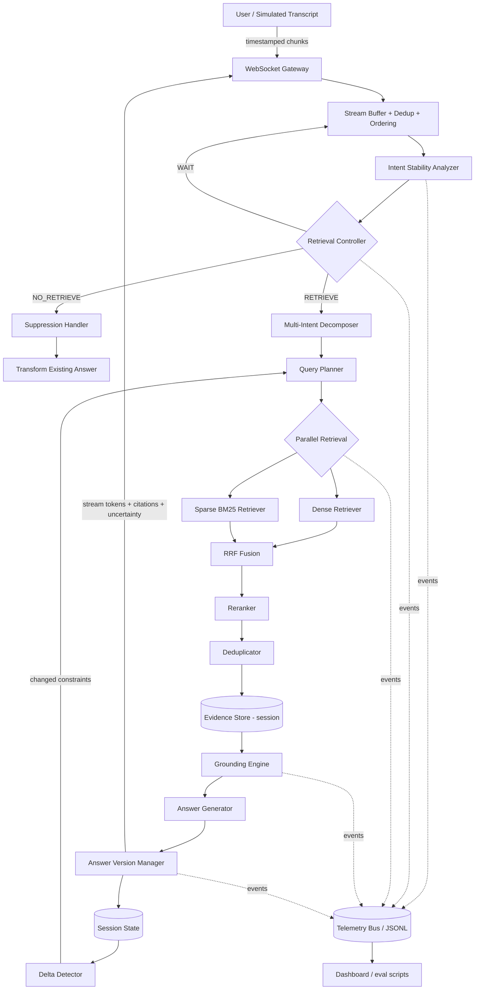

# ANTIGRAVITY_MASTER_PLAN.md
## Samsung PRISM GenAI Hackathon 3.0 — Theme 4: Streaming Live RAG

> Single source of truth for the project. Written as a senior architect's specification for an autonomous coding agent (Antigravity).
> Every statement is tagged: **OFFICIAL REQUIREMENT** (from Samsung material), **PROJECT DESIGN DECISION** (ours), **ENGINEERING RECOMMENDATION** (advice, overridable with justification), **OPEN QUESTION** (unresolved; do not guess).

---

# 0. READ FIRST — CRITICAL FINDINGS FROM THE SOURCE AUDIT

These findings came from actually opening every file in the provided ZIP. They change what can be built and must be resolved before or during Phase 0.

| # | Finding | Impact | Tag |
|---|---------|--------|-----|
| F1 | **The ZIP contains NO corpus, NO dataset, NO sample queries, NO held-out benchmark.** It has 6 guide PDFs, 1 DOCX form, 1 PPTX template. | The Theme 4 corpus domain is **unknown**. The plan MUST be corpus-agnostic. Antigravity must NOT invent a corpus and present it as official. | OPEN QUESTION (O1) |
| F2 | The main brochure says "Corpus provided; voice input may be simulated from transcripts", but no corpus link exists in the files. | Ask `prism@samsung.com` (official queries address) / check the Google Form / any mentor communication for the corpus. | OPEN QUESTION (O1) |
| F3 | **Brochure timeline: Final Submission closes 25 Sep 2026, 11:59 PM. Registration closed 16 Sep. Top 15 announced 9 Oct. Final demo 15 Oct.** The brochure also says dates are "tentative and may shift slightly". | If the working date is after 25 Sep, the submission window may have closed. The team must verify with the organizers whether the submission link is still open / whether dates shifted. Do not assume either way. | OPEN QUESTION (O2) |
| F4 | The Theme 4 Guide is a **scanned image PDF** (no text layer). The JSON output example on page 4 is **visually truncated at the right margin** in the source (the `"answer"` and `"uncertainty"` strings are cut off). | Requirements below were read visually. The output schema's exact string fields beyond the visible part are unknown; use the visible structure and keep extra fields additive. | OPEN QUESTION (O3) |
| F5 | The guide describes the benchmark as a **held-out, private replay** ("Prompts, queries, and canned responses must not be embedded in application code"). | We never see the real test prompts. Our own test set must be authored by us, from the real corpus once obtained, and must be kept out of application code. | OFFICIAL REQUIREMENT |
| F6 | The LLM is **not specified** anywhere. Only "Simple and cheap beats a heavy agent orchestration stack" and "cost per turn" are stated. | Model choice, and whether an external API is permitted, is undecided. Design a swappable provider interface with an offline fallback. | OPEN QUESTION (O4) |
| F7 | Every example in the guide (venue in Pune, cancellation policy, catering, travel reimbursement) hints at an **enterprise/policy/venue-style corpus**. | This is an **inference from examples only**. It must NOT drive schema or code. The examples are illustrative, not proof of the corpus domain. | ENGINEERING RECOMMENDATION |

**Consequence for build order:** Phases 0–1 must produce a *corpus-adapter layer* so the ingestion pipeline can be pointed at whatever the real corpus turns out to be. Until the real corpus arrives, Antigravity may develop against a clearly-labelled **synthetic development fixture** (see §9.4) that is never used to report benchmark numbers as "official".

---

# 1. SOURCE AUDIT

Files inspected (all 8 files in `fwdsamsungprismgenaihackathon3_0registrationli.zip`, 3.7 MB):

| File | What it contains | Relevant Theme 4 info | Mandatory? | Effect on implementation |
|------|------------------|-----------------------|-----------|--------------------------|
| `Theme 4 Guide_RAG.pdf` (6 pp, scanned image) | The full Theme 4 spec: problem, pipeline, hard rules, event examples, 6 evaluation gates, pitfalls, roadmap, deliverables | **Everything** — this is the authoritative spec | **Yes** | Drives §2 (requirements register), all architecture, evaluation, deliverables |
| `Samsung PRISM_Y2026_GenAI_Hackathon_3rd_Edition.V2(2).pdf` (15 pp, text) | Hackathon brochure: 5 themes, timeline, format, scoring weights, submission rules, team rules | Theme 4 summary card ("Streaming Live RAG"), scope/constraints, tech focus, **scoring rubric**, **submission rules** (tag name, naming, deliverables) | **Yes** (submission and scoring rules) | Drives submission checklist, demo emphasis, tag `PRISM_GENAI_HACKATHON_Y2026` |
| `CollegeName_TeamName_Submission.pptx` | 12-slide template: theme, gaps, solution + architecture diagram, demo, stack, impact, innovation/results/limitations, what's next, differentiation, GitHub checklist | Defines required deck content | **Yes** (brochure says follow the template/nomenclature) | Drives §17 deck plan. File must be named `CollegeName_TeamName` per brochure |
| `LangAI3.0_AI_Disclosure.docx` | AI Usage Disclosure form: team, AI usage purpose, per-feature origin (self/AI/both), tools, prompts, ethics confirmation, sign-off | None technical. Requires **per-feature disclosure of AI-generated code, tools and prompts** | Not stated as mandatory in the brochure, but included in the pack | **OPEN QUESTION (O5)** — confirm whether required. Recommendation: fill it regardless, since Antigravity generates code. Keep a `docs/AI_USAGE_LOG.md` from day one |
| `theme1_guidelines.pdf` | Theme 1 (code intelligence) guidelines | None | No | Ignore. Do not import requirements from it |
| `Theme 2_Troubleshooting_Smart Guided Troubleshooting Engine.pdf` | Theme 2 spec | None | No | Ignore |
| `Theme 3 - Evaluation Criteria.pdf` | Theme 3 evaluation | None (searched for "corpus"/"RAG"/"Theme 4": no relevant hits) | No | Ignore. Do NOT apply Theme 3 gates to Theme 4 |
| `Theme 5_Guide.pdf` | Theme 5 (interruptible agents) | None for Theme 4 scoring. Conceptually adjacent (full-duplex), but a different theme | No | Ignore. Theme 4 must not be presented as Theme 5 |

**Not present in the ZIP (explicitly confirmed):** corpus documents, any dataset, evaluation data, sample streaming transcripts, expected-answer files, Dockerfile/compose examples, reference implementation, allowed-model list, API keys, benchmark protocol beyond the six gates.

---

# 2. OFFICIAL REQUIREMENTS REGISTER (Theme 4)

Each row has a stable ID. Every phase's acceptance criteria and the final checklist reference these IDs. Antigravity must keep this table in `docs/REQUIREMENTS_TRACE.md` and mark each row verified with evidence.

## 2.1 Problem and target (Guide §1, brochure Theme 4 card)

| ID | OFFICIAL REQUIREMENT |
|----|----------------------|
| R-P1 | Build an **event-driven Streaming Live RAG Engine** |
| R-P2 | **Listens incrementally:** processes **timestamped transcript chunks** in real time, predicting retrieval intent before the user finishes speaking |
| R-P3 | **Decomposes multi-intent queries:** identifies and parallelizes retrieval for multiple discrete sub-questions in one utterance |
| R-P4 | **Refines rather than restarts:** selectively updates answers **and citation graphs** when late constraints arrive, preserving session state |
| R-P5 | **Guarantees corpus grounding:** strict provenance and citation checks; explicit uncertainty indicators when evidence is insufficient |
| R-P6 | Brochure scope: full-duplex, begin retrieving before utterance ends; corpus provided; **voice input may be simulated from transcripts**; session-scoped memory only; "simple and cheap beats heavy agent orchestration" |
| R-P7 | Brochure "what to build": intent understanding that decides **whether an utterance needs retrieval at all**; decompose one command into several queries; fuse and rerank across sub-queries into one grounded answer; use supplementary detail to sharpen the previous answer, not restart |
| R-P8 | Brochure "report": **retrieval recall, answer groundedness, time-to-first-token, cost per turn** |

## 2.2 Pipeline components (Guide §2)

| ID | OFFICIAL REQUIREMENT |
|----|----------------------|
| R-C1 | **Retrieval Controller:** intent stability check; decision ∈ {**Wait, Retrieve, No-Retrieval**}. Challenge: early-retrieval latency vs. noisy searches on incomplete thoughts |
| R-C2 | **Multi-Intent Decomposer:** extract sub-queries; **parallel intent routing**. Challenge: orthogonal questions without losing context or over-fragmenting |
| R-C3 | **Corpus Retrieval & Fusion:** search supplied corpus; **dense/sparse hybrid scoring**; **re-rank and deduplicate** chunks |
| R-C4 | **Evidence Fusion & Reranking:** collect candidates across sub-queries, reconcile redundant evidence, rank snippets for relevance and factual density. Challenge: merge multi-source evidence without diluting context or introducing contradictory facts |
| R-C5 | **Session-Aware Synthesis:** incremental answer update; grounding and citation check; explicit uncertainty flag |
| R-C6 | **Session-Only Refinement:** apply late-arriving constraints (date adjustments, exceptions) onto **existing answer states** without clearing session context. Challenge: track answer versions and **mutate only affected claims** rather than re-running full-corpus retrieval |
| R-C7 | **Observability Telemetry:** real-time event logs capturing **timestamps, retrieval decisions, source mappings, version transitions, and token costs**; clean structured telemetry under sub-second streaming |
| R-C8 | Output: **streamed answer + grounded citations + observability telemetry** |

## 2.3 Hard engineering rules (Guide §3)

| ID | OFFICIAL REQUIREMENT |
|----|----------------------|
| R-H1 | **Corpus isolation:** all retrieved evidence derives exclusively from the provided corpus. No external web scraping, third-party knowledge bases, or **unindexed parametric model memory** may be used to answer factual claims |
| R-H2 | **No hardcoding / no precomputation:** benchmark replay is held-out and private. Prompts, queries and **canned responses must not be embedded in application code** |
| R-H3 | **Rigorous factual grounding:** every factual assertion attributed to verifiable corpus chunk IDs or section markers, format **`[Doc_ID §Section]`**. If the corpus lacks evidence for a sub-intent, **explicitly emit an uncertainty indicator or request targeted clarification** |
| R-H4 | **Session-bound state:** no cross-session profiling or persistent user tracking across independent test runs. Memory strictly ephemeral and scoped to the active session |
| R-H5 | **Architectural parsimony:** multi-agent frameworks / complex orchestration are judged on cost-to-performance. **Every added component must justify its latency and compute overhead** |

## 2.4 Event specifications (Guide §4) — behavioral contract

| ID | OFFICIAL REQUIREMENT (from Examples 1–3) |
|----|----------------------|
| R-E1 | **Example 1 (incremental multi-intent):** stream of chunks with timestamps (0.0s "I need to plan a customer workshop in…" → Wait; 0.8s "…Pune for 30 people, and I need…" → **Provisional Retrieve** on stable geographic+capacity entities, logged `retrieval_started`; 1.6s "…the cancellation policy and the catering options." → **Decompose & parallel retrieve** into 3 sub-queries; 2.1s [Utterance End] → **Synthesize** one unified answer with citations, **noting unverified aspects**) |
| R-E2 | **Structured output event record** (visible fields): `retrieval_events[]` each with `timestamp_s`, `query`, `trigger` (`provisional` \| `multi_intent`); `sub_queries[]`; `answer`; `citations[]` (e.g. `"Doc_12 §2"`); `uncertainty` (free-text statement of what could not be verified) |
| R-E3 | **Example 2 (late detail, refine not restart):** Step 1 initial request → retrieve, cited summary, store evidence + **Answer Version 1** in session memory. Step 2 late detail → **does not restart session**, recognizes modification to existing topic, **dispatches targeted queries only for the delta**. Step 3 → refined response; **preserves prior citations, adds delta citations, increments to Answer Version 2** |
| R-E4 | **Example 3 (query suppression):** e.g. "Please repeat your last answer in two bullets" → controller evaluation `retrieval_required: false`, `reason: presentation_restructuring`. Transforms existing session context; **no vector search executed**; **retains prior citations without fabricating new ones** |

## 2.5 Evaluation gates (Guide §5) — EXACT THRESHOLDS

| Gate | Criterion | OFFICIAL target threshold | Official validation method |
|------|-----------|---------------------------|----------------------------|
| **G1** | Reproducibility | **Pass / Fail** | Container launches via a **single command on a clean machine**; automated replay suite completes **without manual intervention** |
| **G2** | Early Retrieval | **≥ 80% of eligible queries** | Retrieval commences **prior to final transcript completion** on held-out streaming prompts, **maintaining low false-trigger rates on no-retrieval cases** |
| **G3** | Multi-Intent Identification | **≥ 70% of compound queries** | Accurately identifies and isolates **at least two distinct sub-intents** in compound test utterances |
| **G4** | Factual Grounding | **≥ 85% citation support** | All sampled factual assertions supported by cited corpus chunks; **zero fabricated or hallucinated document IDs** |
| **G5** | Session Refinement | **Verified state continuity** | Late-arriving constraints narrow or update existing responses **without clearing session state or re-executing full-corpus search** |
| **G6** | Telemetry & Observability | **100% trace coverage** | Structured logs/dashboards capture **execution timestamps, retrieval triggers, citations, answer version lineage, and token cost** |

> "Low false-trigger rate" in G2 has **no numeric threshold** in the guide. → OPEN QUESTION (O6). Recommendation: set an internal target (e.g. ≤10% false-trigger on no-retrieval cases) and label it PROJECT DESIGN DECISION, never as official.

## 2.6 Pitfalls the guide names (Guide §6) — treat each as a test target

| ID | Pitfall | Our counter (see phases) |
|----|---------|--------------------------|
| PF1 | Eager/premature retrieval on every token → thrashing, cost, noisy context | Controller with stability gating + cooldown (P6) |
| PF2 | Context loss on late constraints (reset → doubled latency, disjointed replies) | Session state + delta retrieval (P9–P10) |
| PF3 | Citation hallucination (`[Doc_999]`) or citing chunks that don't contain the stated fact | Two-stage grounding: ID existence + content support (P12) |
| PF4 | Ignoring presentation-only turns (querying the vector DB when user asks to reformat/shorten/translate) | Suppression classifier (P11) |
| PF5 | Over-fragmenting a simple question into near-identical sub-queries | Merge/dedupe of sub-queries, single-intent guard (P7) |

## 2.7 Official roadmap (Guide §7) and deliverables (Guide §8)

**Official roadmap (5 phases):** (1) corpus audit, indexing, chunking optimization; baseline dense/sparse hybrid pipeline; structured event schemas (Controller, Telemetry, Output). (2) Incremental transcript chunking **simulator**; intent stability classifier & retrieve/wait/suppress policy; early-retrieval timestamp logging and latency measurement. (3) Query decomposition module; parallelized retrieval across sub-queries; **Reciprocal Rank Fusion (RRF)** and dedup reranker. (4) Ephemeral session memory store; **answer delta engine mutating only affected claims**; strict grounding verification and explicit uncertainty flagging. (5) End-to-end telemetry (timestamps, latencies, tokens, versions); benchmark execution across held-out streaming test sets; **single-command container packaging** and deployment docs.

**OFFICIAL deliverables checklist (Guide §8):**

| ID | Deliverable |
|----|-------------|
| D1 | **Reproducible Repository:** source, **pinned dependency lockfiles**, environment config templates, one-command run (`docker compose up` or clean CLI runner) |
| D2 | **System Architecture Brief (≤ 6 pages):** design rationale, retrieval trigger logic, query decomposition strategy, data provenance, trade-offs, failure-mode mitigations |
| D3 | **Benchmarking & Evaluation Report:** quantitative comparison **against the baseline pipeline**, documenting **at least three analyzed edge-case failures** and **at least two architectural ablation experiments** (examples given: hybrid vs. dense-only retrieval; rule-based vs. model-based controller) |
| D4 | **System Demonstration Video (≤ 5 minutes):** early retrieval triggering, multi-intent decomposition, late-detail refinement, presentation query suppression, runtime telemetry |
| D5 | **Telemetry & Observability Schema:** structured logs of end-to-end request latencies, retrieval trigger events, answer version updates, **inference cost estimations** |

## 2.8 Brochure submission + scoring rules (apply to us)

| ID | OFFICIAL REQUIREMENT |
|----|----------------------|
| S1 | Submit via Google Form: public/shared GitHub repo, demo video ≤ 5 min (YouTube or Drive), presentation (PPT/PDF) named per template nomenclature `CollegeName_TeamName` |
| S2 | README with **reproducible setup instructions, Docker files, other requirements** |
| S3 | Create a **release tag `PRISM_GENAI_HACKATHON_Y2026`** on the final commit. **The tagged commit is what gets judged.** Everything referenced in the PPT/video/docs must be present in the tagged commit |
| S4 | "Teams NOT following the submission guideline would lead to **direct disqualification**" |
| S5 | Scoring: **Working prototype & functionality 30%; Technical depth & feasibility 25%; Innovation & originality 20%; Relevance to theme 15%; Presentation & documentation 10%** |
| S6 | Team: ≤ 4 members, single college, one theme, one submission per team |
| S7 | Final demo round (top 15): live walkthrough of the working prototype + Q&A on design decisions and trade-offs |

**Implication of S5 (PROJECT DESIGN DECISION):** 55% of the score is "does it work + is it technically sound". A polished dashboard is worth at most a slice of the 10% presentation + part of the 30% functionality. Spend engineering effort in this order: correctness of gates > reproducibility > telemetry > UI polish.


---

# 3. THE ACTUAL PROBLEM (what Theme 4 is solving)

Theme 4 is **not** "RAG but faster". It is a **control and state problem layered on top of retrieval**. Three things are broken in batch RAG, and each maps to a distinct architectural mechanism:

1. **Turn-taking latency.** Batch RAG idles until the user finishes. Fix: *speculative* retrieval while input is still arriving. But speculation without discipline causes PF1 (thrashing). So the hard part is the **decision** (Wait/Retrieve/No-Retrieve), not the retrieval.
2. **Compound utterances.** One natural sentence hides several orthogonal information needs. A single embedding of the whole utterance retrieves a blurry average of all of them. Fix: **decompose into sub-queries and retrieve per intent in parallel**, then **fuse**. The hard part is *not over-fragmenting* (PF5).
3. **Late constraints.** "Actually the trip was international" changes *part* of the answer. Batch RAG restarts (PF2). Fix: persistent **session state** with **claim-level provenance**, so we can compute a **delta**, retrieve only for the affected scope, and mutate only the claims that depend on it.

Cross-cutting: **grounding** (every claim traceable to a corpus chunk, R-H3) and **observability** (every decision is logged, R-C7), because the evaluation gates are computed from behavior, and behavior is only provable through traces.

**Batch RAG:** `finish → retrieve → generate → answer`.

**Streaming Live RAG (ours), with the reason each step exists:**

| Step | Why it exists |
|------|---------------|
| Incremental stream arrives | Source of the latency win; tests need timestamped chunks (R-P2) |
| Stability evaluation | Don't spend retrieval on half-formed thoughts (PF1) |
| Controller: WAIT / RETRIEVE / NO-RETRIEVE | The core policy; also the source of the G2 false-trigger metric |
| Early retrieval when justified | Latency reduction (G2) |
| Multi-intent detection + subquery generation | One embedding cannot serve several orthogonal needs (G3) |
| Parallel dense + sparse retrieval | Hybrid recall; parallelism hides per-intent latency (R-C3) |
| Fusion (RRF) → rerank → dedup | Merge lists across intents/retrievers without diluting context (R-C4) |
| Grounding check | Prevent PF3; supports G4 |
| Incremental answer generation | Time-to-first-token; answer improves as evidence arrives |
| Session state update | Enables refinement instead of restart (G5) |
| Late-constraint detection → delta retrieval | Only fetch what changed; keep everything else (R-C6) |
| Answer refinement (v2, v3…) | Mutate affected claims only; keep provenance lineage |
| Telemetry across all of it | G6: 100% trace coverage |

---

# 4. MASTER ARCHITECTURE

## 4.1 Design principles (PROJECT DESIGN DECISIONS)

- **One backend process, one frontend, one container** (R-H5, G1). No Redis/Kafka/microservices. In-process async pipeline with an internal event bus.
- **Deterministic first.** Controller, suppression, delta detection and grounding pre-checks are rule-based with config-driven thresholds. An LLM is used only where language understanding is genuinely required (decomposition fallback, claim generation, optional entailment). Every LLM use must be justified in the architecture brief (R-H5).
- **Corpus-agnostic.** A `CorpusAdapter` maps whatever the real corpus looks like into the canonical chunk schema (§9).
- **Everything emits telemetry**; nothing is "logged later".

## 4.2 System diagram



## 4.3 Component catalogue (all 21 requested)

| # | Component | Responsibility | Input → Output | Depends on | Failure modes → mitigation |
|---|-----------|----------------|----------------|-----------|----------------------------|
| 1 | Frontend | Live transcript, controller state, intent graph, evidence, answer versions, telemetry | WS events → UI | Backend WS | WS drop → auto-reconnect, session resume by `session_id` within TTL |
| 2 | Backend (FastAPI) | Host WS/REST, wire components, config | HTTP/WS | all | Crash → container restart policy; health endpoint |
| 3 | Streaming layer | Accept chunks, order, dedup, backpressure, cancel | chunk events → buffered utterance state | Config | Out-of-order/duplicate/late chunks → §6 |
| 4 | Session manager | Create/get/reset/expire sessions; isolation | `session_id` → `SessionState` | none | Leak across sessions → per-session object, no shared mutable globals, test |
| 5 | Retrieval controller | WAIT/RETRIEVE/NO_RETRIEVE decision | utterance state + session → `ControllerDecision` | 3, 4, 6 | Mis-decision → thresholds in config, ablation vs. baseline |
| 6 | Intent detector (stability + type) | Stability score, completeness, query-type class | text → features | 3 | Ambiguity → default WAIT until utterance end |
| 7 | Multi-intent decomposer | Split into intents + constraints + dependencies | utterance → `IntentSet` | 6 | Over-fragmentation → merge step; LLM failure → rule fallback |
| 8 | Query planner | Turn intents into concrete subqueries per retrieval channel; apply constraint substitution | `IntentSet` (+delta) → `RetrievalPlan` | 7, 4 | Duplicate subqueries → similarity dedup |
| 9 | Dense retriever | Embedding kNN | query → ranked chunk IDs | index | Model missing → fail loud, fall back to sparse-only + log |
| 10 | Sparse retriever | BM25 | query → ranked chunk IDs | index | Tokenization mismatch → shared analyzer config |
| 11 | Fusion engine | RRF over lists per intent, across retrievers | ranked lists → fused list | 9, 10 | Score-scale mismatch → RRF is rank-based, immune |
| 12 | Reranker | Optional cross-encoder rescoring | fused top-N → top-K | 11 | Latency → gated by config, decided by ablation |
| 13 | Dedup layer | Remove near-duplicate/overlapping chunks | top-K → deduped | 12 | Over-aggressive dedup drops distinct facts → threshold in config, test |
| 14 | Evidence store | Session-scoped evidence objects with provenance | deduped chunks → `Evidence[]` | 4 | Stale evidence → each item carries `intent_ids` + `retrieved_for` for selective invalidation |
| 15 | Grounding engine | Verify claims ↔ chunks, verify IDs exist | claims + evidence → `VerifiedClaims` | 14, index | Unsupported → drop/flag (§12) |
| 16 | Answer generator | Produce structured claims + prose from evidence only | evidence + session → claims | 14, 17-LLM provider | LLM failure → extractive fallback (§13) |
| 17 | Answer version manager | Persist versions, diff claims, lineage | claims → `AnswerVersion` | 4, 15 | Version corruption → append-only, immutable versions |
| 18 | Session state manager | Requirements/intents/constraints/evidence/history | events → state | 4 | Concurrent updates → per-session asyncio lock |
| 19 | Delta detector | Compare constraint sets, map to intents/claims | old+new state → `Delta` | 18 | False delta → normalization of slot values |
| 20 | Telemetry | Event bus + JSONL sink + metrics | events → files/WS | all | Sink failure must never break the pipeline (swallow + counter) |
| 21 | Evaluation framework | Replay held-out-style streams, compute G1–G6 | scenario files → metrics report | all | Scenario leakage into app code → forbidden by R-H2; scenarios live only under `evaluation/` |

## 4.4 Control flow vs. data flow

- **Control flow:** chunk → stability → controller decision → (retrieve | suppress | wait). Only the controller may trigger retrieval (single choke point ⇒ easy telemetry and easy ablation).
- **Data flow:** `Chunk` → `UtteranceState` → `IntentSet` → `RetrievalPlan` → `RankedList[]` → `FusedList` → `Evidence[]` → `Claim[]` → `AnswerVersion` → stream to UI.
- **Concurrency model (PROJECT DESIGN DECISION):** Python `asyncio`. Retrieval per (intent × channel) is dispatched with `asyncio.gather`; CPU-bound calls (embedding, rerank) go through `run_in_executor` with a bounded pool. A newer retrieval request for the same session cancels superseded in-flight retrievals whose plan is obsolete (cancellation event logged).

---

# 5. RETRIEVAL CONTROLLER (R-C1, G2)

## 5.1 Decision contract

```json
{
  "decision": "RETRIEVE",
  "trigger": "provisional",
  "confidence": 0.86,
  "reason": "stable_entities_and_information_seeking",
  "features": {
    "stability": 0.91, "completeness": 0.62, "query_type": "information_seeking",
    "new_content_tokens": 7, "retrieved_before": false, "cooldown_ok": true
  },
  "retrieval_required": true
}
```

Mapping of user's "SUPPRESS" to the official term: official = **No-Retrieval**; internal enum `NO_RETRIEVE`; UI label "SUPPRESS". Telemetry emits both fields (`decision`, `retrieval_required`, `reason`) so it matches official Example 3 (`retrieval_required: false`, `reason: presentation_restructuring`).

## 5.2 Input features (all deterministic)

| Feature | How computed (ENGINEERING RECOMMENDATION) |
|---------|---------------------------------------------|
| `utterance_end` | Explicit end event from the stream, or silence-gap > `end_silence_ms` |
| `dangling_tail` | Buffer ends with a conjunction/preposition/determiner/auxiliary ("in…", "and I need…", "for the") → strong WAIT signal |
| `entity_completeness` | Presence of a head verb/request frame + at least one content noun/entity (NER via lightweight spaCy model *or* regex+noun-chunk rules) |
| `stability` | Overlap of content-term sets between the current candidate query and the candidate at the previous chunk(s); high overlap over `stability_window` chunks ⇒ stable |
| `query_type` | Rule classifier (§11): information_seeking / constraint_update / followup / transformation / clarification / new_unrelated |
| `new_information_gain` | Content terms in the buffer not covered by any prior retrieval's query terms (session history) |
| `retrieved_before` | Whether a retrieval already covered the same intent signature |
| `changes_previous_request` | Whether new text alters a constraint slot (feeds delta path) |
| `cooldown_ok` | Time/tokens since last retrieval ≥ `min_retrieval_interval_ms` |

## 5.3 Decision logic (pseudocode; thresholds in `configs/controller.yaml`)

```
if empty_or_noise(buffer): return WAIT(reason="empty")
qtype = classify(buffer, session)
if qtype in {transformation, formatting} and session.has_answer:
    return NO_RETRIEVE(reason="presentation_restructuring")          # R-E4
if qtype == clarification_of_answer and answer_covers(session): NO_RETRIEVE
if utterance_end:
    return RETRIEVE(trigger="final") if needs_retrieval(session, buffer) else NO_RETRIEVE
if dangling_tail: return WAIT(reason="dangling_tail")
score = w1*stability + w2*entity_completeness + w3*info_gain + w4*type_prior
if score >= retrieve_threshold and cooldown_ok and info_gain >= min_info_gain:
    return RETRIEVE(trigger="provisional" | "multi_intent" | "delta")
return WAIT
```

Weights, `retrieve_threshold`, `min_info_gain`, `stability_window`, `min_retrieval_interval_ms`, `end_silence_ms` are **all config**. Antigravity must not hardcode any of them in code (validated by a test that greps for numeric literals in `controller/` outside config loading).

## 5.4 Rule-based vs. model-based controller (ablation for D3)

Implement the rule-based controller first (default). Implement an **optional** small model-based variant (LLM classifier over the buffer) behind the same interface **only** for the ablation "rule-based vs. model-based" that the guide names. Keep whichever wins on cost-to-performance (R-H5); report both.

---

# 6. STREAMING ARCHITECTURE

**Choice: WebSocket** (PROJECT DESIGN DECISION). *Why:* bidirectional (client sends chunks, cancels, resets; server pushes events/tokens) over one connection. *Why not SSE:* one-directional; we'd need a parallel POST channel for chunks. *Tradeoff:* slightly more connection handling. *Resources:* negligible.

**Also expose a headless CLI replay runner** (`scripts/replay.py`) that drives the same pipeline with no network. Required for G1's "automated replay suite completes without manual intervention".

| Concern | Design |
|---------|--------|
| Chunk format | `{session_id, seq, t_ms, text, is_final, chunk_id}`; matches official example (timestamps in seconds derivable) |
| Simulated streaming (R-P6) | `StreamSimulator` replays a transcript with per-chunk delays taken from the scenario file (deterministic with a fixed clock option for tests). Real STT is optional and out of scope for scoring |
| Ordering | Per-session `seq` monotonic; buffer holds out-of-order chunks up to `reorder_window_ms` then flushes |
| Duplicates | Idempotency by `(session_id, seq)` and text-hash; duplicates counted in telemetry, ignored |
| Late chunks | Chunk with `seq` older than committed → applied only if it does not contradict later text, else logged `late_chunk_dropped` |
| Partial utterances | Buffer holds `committed_text` + `volatile_tail`; stability analysis uses the tail |
| Debouncing | Controller runs at most every `debounce_ms` or on chunk boundary, whichever is later |
| Backpressure | Bounded `asyncio.Queue` per session; on overflow drop oldest *volatile* analysis work, never chunks; emit `backpressure` event |
| Cancellation | New chunk that invalidates a running speculative retrieval → cancel superseded tasks (`cancel_reason`), result discarded, logged |
| Limits | `max_utterance_chars` (config); overlong → truncated with an `error`-class event |

---

# 7. MULTI-INTENT DECOMPOSITION (R-C2, G3)

**Output contract:**

```json
{
  "intents": [
    {"id":"intent_1","query":"venue capacity for 30 attendees in Pune","type":"information_seeking",
     "constraints":[{"key":"attendees","value":30},{"key":"location","value":"Pune"}],
     "depends_on":[],"anchor_topic":"customer workshop"},
    {"id":"intent_2","query":"cancellation terms and refund policies","type":"information_seeking",
     "constraints":[{"key":"location","value":"Pune"}],"depends_on":[],"anchor_topic":"customer workshop"}
  ],
  "shared_constraints":[{"key":"location","value":"Pune"}]
}
```

(The example strings above illustrate the guide's Example 1; they are **not** corpus facts.)

**Method (PROJECT DESIGN DECISION — hybrid, cheap first):**
1. **Segmentation heuristics:** split on coordinating structure ("and", "also", commas, "as well as", "plus", enumerations) *only* where each side contains its own head noun/topic; this catches "the cancellation policy and the catering options".
2. **Shared-context propagation:** entities/constraints appearing once (Pune, 30 people) are attached to all intents they plausibly modify (`shared_constraints`), so sub-queries stay self-contained without re-fragmenting.
3. **LLM fallback (optional, config flag):** invoked only when heuristics find ≤1 intent but the utterance is long/complex, or produce low confidence. Output must validate against the JSON schema; otherwise fall back to heuristics.
4. **Anti-over-fragmentation (PF5):** (a) merge intents whose subqueries have embedding/lexical similarity ≥ `intent_merge_threshold`; (b) minimum content-term count per intent; (c) a single-intent guard: if the head topic is the same and the extra clauses are only modifiers/constraints, keep **one** intent with constraints.
5. **Dependencies:** `depends_on` is used only when a later intent needs an earlier one's result (rare; default empty ⇒ fully parallel). Cycles rejected.
6. **Related requirements grouping:** constraints with the same key/topic are grouped under the intent they modify; unaffiliated constraints go to `shared_constraints`.
7. **Incremental:** decomposition runs on each RETRIEVE decision; new intents that appear later (e.g., at 1.6s) are **added** to the existing intent set (stable IDs), not recomputed from scratch.

**G3 measurement:** for each compound test utterance, gold sub-intents (authored by us) vs. predicted; success = ≥2 distinct correct intents isolated.

---

# 8. HYBRID RETRIEVAL (R-C3, R-C4)

Pipeline: **Dense ‖ Sparse → RRF fusion → (optional) rerank → dedup → evidence set.** Run per intent, in parallel.

## 8.1 Technology decisions (ENGINEERING RECOMMENDATIONS — confirm after O1 reveals corpus size)

| Layer | Choice | Why this | Why not alternatives | Tradeoff | Resources |
|-------|--------|----------|----------------------|----------|-----------|
| Sparse | `rank_bm25` (or `bm25s` if corpus large) | Pure Python, zero services, deterministic, debuggable | Elasticsearch/OpenSearch: extra service, breaks single-command simplicity (R-H5); Whoosh: unmaintained | Slower on very large corpora | RAM ≈ tokenized corpus |
| Dense index | **FAISS-CPU `IndexFlatIP`** (exact, in-process) or plain NumPy matmul if corpus is small | Exact search is fast for ≤ ~1M chunks on CPU; no server | Qdrant: separate container, unnecessary; approximate indexes add nondeterminism | Not distributed | Index ≈ n × dim × 4 bytes |
| Embeddings | `sentence-transformers` small model, e.g. `BAAI/bge-small-en-v1.5` or `all-MiniLM-L6-v2` (**OPEN QUESTION O7: license + offline availability; multilingual need depends on corpus**) | Small, CPU-friendly, strong retrieval quality per cost; **weights baked into the image** for offline/G1 | Large embedding APIs: cost, latency, external dependency | Lower ceiling than large models | ~100–130 MB weights |
| Fusion | **Reciprocal Rank Fusion** (`k` in config) | Officially named in Guide §7; scale-free; robust | Weighted score sum: needs calibration | Ignores score magnitude | trivial |
| Reranker | Cross-encoder (e.g. `cross-encoder/ms-marco-MiniLM-L-6-v2`) **optional, off by default until ablation proves value** | Improves precision on top-K | Always-on: latency vs. R-H5 | +latency per turn | ~90 MB |
| Dedup | Chunk-ID overlap + normalized-text/embedding similarity ≥ `dedup_threshold` + adjacent-chunk merge | Removes redundant evidence (R-C4) | none | may merge distinct near-identical facts → threshold tested | trivial |

Every choice above must be re-validated in `docs/DECISIONS.md` after the corpus is known; Antigravity must record measured latency/recall for the chosen configuration (no invented numbers).

## 8.2 Per-intent vs. cross-intent fusion

1. For each intent: RRF over {dense list, sparse list} → intent list.
2. Cross-intent: reserve a **quota per intent** (`min_chunks_per_intent`) so a dominant intent cannot crowd out others (prevents context dilution, R-C4), then fill remaining slots by global rank.
3. Rerank within each intent's list against that intent's subquery (not against the whole utterance).
4. Dedup globally; when a chunk serves multiple intents, keep one Evidence item with multiple `intent_ids`.
5. Contradiction watch: evidence pairs from different documents sharing subject + differing numeric/date/polarity are flagged `potential_conflict` for the grounding stage (§12).

---

# 9. CORPUS PIPELINE

## 9.1 Stages

`Raw corpus → load → parse → clean → structure detection → section extraction → chunking → metadata → stable chunk IDs → embeddings → vector index → sparse index → integrity manifest`

- **CorpusAdapter interface** (`backend/ingest/adapters/`): one adapter per discovered format (PDF/DOCX/HTML/MD/TXT/JSON/CSV). Antigravity writes adapters **only for formats actually found** in the corpus (O1). Unsupported/corrupt files are skipped with a logged reason and counted in a manifest (never crash ingestion).
- **Structure detection:** headings, numbered sections, tables (kept as atomic units or serialized row-wise), lists. Section markers must be recoverable because citations are `[Doc_ID §Section]` (R-H3).
- **Chunking (PROJECT DESIGN DECISION):** section-aware; target `chunk_target_tokens` with `chunk_overlap_tokens`, never crossing a section boundary unless the section is tiny; parameters tuned by measured retrieval recall on our dev queries (Phase 3), not by guess.
- **Stable chunk IDs:** `chunk_id = "{document_id}::{section_id}::{ordinal}"` plus `content_hash` (sha256 of normalized text). IDs must be deterministic across rebuilds (G1, R-H3). The **citation string** is derived from `document_id` and `section_id`, and the mapping from citation → chunk must be exact and invertible.
- **Doc_ID convention:** if the corpus already has IDs (e.g. `Doc_12`), **use them verbatim**; do not rename. If not, derive from filename slug and document the rule. → OPEN QUESTION O8: real corpus ID convention.

## 9.2 Canonical chunk schema

```json
{
  "chunk_id": "Doc_12::S2::0003",
  "document_id": "Doc_12",
  "section_id": "2",
  "section_title": "Cancellation Policy",
  "page": 4,
  "text": "…",
  "content_hash": "sha256:…",
  "token_count": 187,
  "prev_chunk_id": "Doc_12::S2::0002",
  "next_chunk_id": "Doc_12::S2::0004",
  "metadata": {"source_path": "…", "doc_title": "…", "doc_type": "…", "language": "en", "extra": {}}
}
```

`page`, `section_title`, and `metadata.extra` are nullable; adapt after O1. Fields required for citation verification (`chunk_id`, `document_id`, `section_id`, `text`) are non-nullable.

## 9.3 Corpus isolation (R-H1) — enforced technically

- Retrievers only read from indexes built from the corpus directory. The generator receives **only** Evidence objects. Prompts instruct "answer only from the provided evidence"; the grounding engine enforces it after the fact (prompt compliance is never trusted).
- No network egress from the retrieval/grounding path. If an external LLM API is allowed (O4), it receives evidence text only and is the single permitted egress, behind one adapter, logged.
- Test: runtime assertion that every `document_id` in any answer citation exists in the corpus manifest.

## 9.4 Development fixture (until the real corpus arrives)

Antigravity may create `data/dev_fixture/` (small synthetic documents shaped like generic policy/venue docs, clearly headed `SYNTHETIC — NOT OFFICIAL`) purely to develop and unit-test plumbing. Rules: fixture data lives only under `data/dev_fixture/` and `tests/`; **no benchmark or gate number computed on it may be reported as an official result**; reports must print the corpus name/hash they were computed on.

---

# 10. SESSION STATE (R-H4, R-C6, G5)

Ephemeral, in-memory, per `session_id`, destroyed on reset or TTL expiry. **Never written to disk across sessions; no user profile.** (Telemetry logs are run artifacts, not user tracking; they must contain no cross-session identifiers beyond the run's own session IDs.)

```json
{
  "$schema": "http://json-schema.org/draft-07/schema#",
  "title": "SessionState",
  "type": "object",
  "required": ["session_id","created_at","goal","intents","constraints","evidence","answer_versions","history"],
  "properties": {
    "session_id": {"type":"string"},
    "created_at": {"type":"string","format":"date-time"},
    "goal": {"type":"object","properties":{"text":{"type":"string"},"anchor_topic":{"type":"string"}}},
    "utterance": {"type":"object","properties":{"committed_text":{"type":"string"},"volatile_tail":{"type":"string"},"last_seq":{"type":"integer"},"ended":{"type":"boolean"}}},
    "intents": {"type":"array","items":{"$ref":"#/definitions/Intent"}},
    "constraints": {"type":"object","additionalProperties":{"$ref":"#/definitions/Constraint"}},
    "changed_constraints": {"type":"array","items":{"$ref":"#/definitions/Delta"}},
    "queries_issued": {"type":"array","items":{"$ref":"#/definitions/IssuedQuery"}},
    "evidence": {"type":"array","items":{"$ref":"#/definitions/Evidence"}},
    "active_evidence_ids": {"type":"array","items":{"type":"string"}},
    "answer_versions": {"type":"array","items":{"$ref":"#/definitions/AnswerVersion"}},
    "current_version": {"type":"integer"},
    "grounding": {"type":"object","properties":{"supported":{"type":"integer"},"partial":{"type":"integer"},"unsupported":{"type":"integer"},"conflicts":{"type":"integer"}}},
    "history": {"type":"array","items":{"type":"object"}},
    "telemetry_refs": {"type":"array","items":{"type":"string"}}
  },
  "definitions": {
    "Constraint": {"type":"object","required":["key","value"],"properties":{"key":{"type":"string"},"value":{},"source_seq":{"type":"integer"},"status":{"enum":["active","superseded"]}}},
    "Intent": {"type":"object","required":["id","query","type"],"properties":{"id":{"type":"string"},"query":{"type":"string"},"type":{"type":"string"},"constraint_keys":{"type":"array","items":{"type":"string"}},"depends_on":{"type":"array","items":{"type":"string"}},"status":{"enum":["pending","retrieved","answered","invalidated"]}}},
    "IssuedQuery": {"type":"object","required":["query","intent_id","trigger","t_ms"],"properties":{"query":{"type":"string"},"intent_id":{"type":"string"},"trigger":{"enum":["provisional","final","multi_intent","delta"]},"t_ms":{"type":"integer"}}},
    "Evidence": {"type":"object","required":["evidence_id","chunk_id","document_id","section_id","text","intent_ids"],"properties":{"evidence_id":{"type":"string"},"chunk_id":{"type":"string"},"document_id":{"type":"string"},"section_id":{"type":"string"},"text":{"type":"string"},"intent_ids":{"type":"array","items":{"type":"string"}},"scores":{"type":"object"},"retrieved_at_version":{"type":"integer"},"status":{"enum":["active","retired","superseded"]}}},
    "Delta": {"type":"object","required":["key","old","new"],"properties":{"key":{"type":"string"},"old":{},"new":{},"affected_intents":{"type":"array","items":{"type":"string"}}}},
    "AnswerVersion": {"type":"object","required":["version","claims","created_at"],"properties":{"version":{"type":"integer"},"claims":{"type":"array"},"uncertainty":{"type":"array"},"diff_from_previous":{"type":"object"},"created_at":{"type":"string"}}}
  }
}
```

Implement as **Pydantic v2 models**; export the JSON Schema from the models into `docs/schemas/` so the schema and code cannot drift.

---

# 11. QUERY TYPE CLASSIFICATION & SUPPRESSION (R-E4, PF4)

Deterministic rule classifier over (buffer, session). Categories:

| Class | Signals | Retrieval? |
|-------|---------|-----------|
| `information_seeking` | question/request frames ("what", "how", "tell me", "I need X for Y") with new topical content | **Yes** |
| `constraint_update` | "actually", "instead", "also", "the trip was…", number/date/place mentions altering an existing constraint | **Delta only** (§12) |
| `followup` | anaphora ("that", "it", "those") + new question about the same topic | Yes if question is not answerable from active evidence; else No |
| `transformation` | verbs: summarize, shorten, rephrase, translate, bullets, table, one sentence, "make it…", "repeat…" + anaphora and a session answer exists | **No** (`presentation_restructuring`) |
| `clarification` | "explain point 2", "what do you mean" referring to a prior claim | **No** if claim + evidence exist in session, else Yes |
| `new_unrelated` | low topical overlap with session goal and no anaphora | Yes, **new topic branch** (keep session, mark previous answer as background) or reset if user says so |

**Guards:** transformation with no prior answer ⇒ treat as information_seeking (nothing to transform). Coverage check for "explain point 2": suppress only if the referenced claim's evidence is active in session; otherwise retrieve for that claim. Transformations must **reuse existing citations; never create new ones** (R-E4). An optional LLM classifier may be added only if the rule classifier's measured accuracy on our labelled set is inadequate — justify in D2.

---

# 12. DELTA DETECTION & TARGETED RETRIEVAL (R-C6, G5)

## 12.1 Constraint extraction
Slot extraction produces `{key: value}` from the utterance (rules + light NER; LLM optional). Values are **normalized** (numbers, units, dates, casing) before comparison to avoid false deltas.

## 12.2 Delta computation

```
OLD {"capacity":30,"location":"Pune"}  →  NEW {"capacity":50,"location":"Pune"}
Delta {"capacity":{"old":30,"new":50}}           # location unchanged → untouched
```
Types: `changed` (same key, new value), `added` (new key; e.g., `travel_scope=international`), `removed`.

## 12.3 Mapping chain
`Delta → affected constraint_keys → intents referencing those keys → retrieval scope (rewritten subqueries with new value) → targeted retrieval → evidence merge`.
- **Added constraints with no existing slot** (official Example 2: "the trip was international and booking was after travel"): create a new constraint, attach to the session `anchor_topic`, and generate **delta subqueries scoped to the anchor** ("international travel reimbursement", "post-travel booking exception"). Only these are dispatched; base-policy retrieval is **not** re-run.
- **Unaffected intents:** their evidence stays `active`; no retrieval; their claims are carried forward byte-identical.
- **Affected evidence:** marked `superseded` only if the new constraint contradicts its applicability; otherwise kept and supplemented.

## 12.4 Proof for G5
Telemetry must show, for a refinement turn: `delta_retrieval_started` with `scope` = affected intents only; **zero** retrieval calls for unaffected intents; session ID and prior `answer_versions` intact; version incremented. The eval script asserts these from the trace, not from output text.

---

# 13. GROUNDING (R-H3, R-C5, G4, PF3)

## 13.1 Objects

```json
// Evidence (session-level, see §10)   Claim:
{
  "claim_id": "c_007", "version_introduced": 1, "text": "…", "intent_id": "intent_2",
  "status": "supported|partial|unsupported|conflicting|no_evidence",
  "citations": [{"document_id":"Doc_31","section_id":"4","chunk_id":"Doc_31::S4::0001","display":"[Doc_31 §4]","support_score":0.91,"quoted_span":"…"}],
  "depends_on_constraints": ["location"], "removed_in_version": null
}
```

## 13.2 Two-stage verification (PROJECT DESIGN DECISION)
1. **Existence gate (hard):** every cited `chunk_id`/`document_id`/`section_id` must exist in the corpus manifest **and** in the current session evidence. Otherwise the citation is deleted and logged `citation_invalid`. This enforces "zero fabricated document IDs".
2. **Support gate:** the claim must be supported by the cited chunk's text. Cheap-first check: key-term/number/entity containment + sentence-level overlap; for borderline cases an optional NLI/cross-encoder or LLM-judge (config flag; cost logged). The claim's atomic facts (numbers, named entities, negations) must each appear in evidence; a claim asserting a number not present in the chunk ⇒ unsupported.

Generation instruction: the generator emits **structured claims with evidence IDs** (not free prose with ad-hoc citations); prose is composed from verified claims, so citation rendering `[Doc_ID §Section]` is done by code from IDs, never typed by the model.

## 13.3 Status handling

| Status | Handling |
|--------|----------|
| Fully supported | Emit with citation(s) |
| Partially supported | Emit only the supported part; the remainder is listed in `uncertainty` |
| Unsupported | **Dropped from the answer**; recorded in telemetry and (if the sub-intent then has nothing) surfaced as uncertainty |
| Conflicting evidence | Emit both, each with its citation, marked "sources disagree"; never silently pick one |
| No evidence for a sub-intent | Emit "I couldn't find sufficient support in the provided corpus for <sub-intent>", and where useful a **targeted clarification request** (R-H3) |

---

# 14. UNCERTAINTY (part of the architecture, R-H3)

- Each intent ends with a status ∈ {answered, partial, unanswered}. The output object's `uncertainty` field lists per-intent statements (matching the official record's `uncertainty` field).
- The generator is never asked to "fill in" a gap; gaps are produced deterministically by the grounding stage.
- Retrieval-quality gate: if the top fused score for an intent falls below `min_relevance` (config, calibrated on dev queries), treat as no-evidence rather than let the LLM improvise.
- The UI shows uncertainty as first-class content, not a footnote.

---

# 15. ANSWER VERSIONING (R-E3)

```json
{
  "version": 2, "parent_version": 1, "created_at": "…", "trigger_delta": {"travel_scope":{"old":null,"new":"international"}},
  "claims": [ /* full claim list for this version */ ],
  "diff_from_previous": {
    "claims_added": ["c_011","c_012"], "claims_removed": [], "claims_modified": ["c_003"], "claims_preserved": ["c_001","c_002"],
    "evidence_added": ["ev_09"], "evidence_preserved": ["ev_01","ev_02","ev_03"], "evidence_retired": []
  },
  "uncertainty": [ … ], "token_cost": {"prompt":0,"completion":0,"est_usd":0.0}
}
```
Versions are **immutable, append-only**. Refinement generation receives: previous version's claims + preserved evidence + new evidence + the delta, and is instructed to change only claims that depend on the changed constraint; a code-level check then verifies that claims not dependent on the delta are unchanged (a violated invariant is an error, not a warning).

---

# 16. TELEMETRY (R-C7, G6, D5)

## 16.1 Envelope (every event)

```json
{
  "event_id":"uuid","event_type":"retrieval_decision","session_id":"…","request_id":"…","seq":42,
  "ts":"2026-…Z","t_stream_ms":800,"latency_ms":3.2,
  "answer_version":1,"intent_id":null,"payload":{ }
}
```
`t_stream_ms` = position on the stream clock (so "retrieval before utterance end" is provable). `latency_ms` present where applicable. Payload varies by event.

## 16.2 Event types (superset of those requested + those needed for G6)

`stream_received`, `chunk_duplicate_ignored`, `chunk_late`, `intent_stability_updated`, `retrieval_decision` (payload includes `decision`, `retrieval_required`, `reason`, `confidence`, `features`), `retrieval_suppressed`, `intent_detected`, `subquery_created`, `dense_retrieval_started|completed`, `sparse_retrieval_started|completed`, `retrieval_cancelled`, `evidence_fused`, `reranking_completed`, `dedup_completed`, `grounding_started|completed` (payload: per-claim status, invalid citations), `answer_token_first`, `answer_generated`, `answer_version_created` (lineage + diff), `session_updated`, `constraint_changed`, `delta_retrieval_started|completed`, `llm_call` (model, prompt/completion tokens, latency, est_cost), `utterance_end`, `session_reset`, `error`.

## 16.3 G6 coverage rule
For every turn, the trace must contain: execution timestamps, ≥1 `retrieval_decision`, all retrieval triggers, all citations (with existence-check results), answer version lineage, and token cost (`llm_call` events; local/extractive paths report `0` tokens explicitly, never omit). A `scripts/check_trace_coverage.py` computes coverage = turns with complete required-event sets ÷ turns; must equal 100%.

## 16.4 Implementation
In-process pub/sub; sinks: (a) JSONL file per run under `runs/<run_id>/telemetry.jsonl`, (b) WS broadcast to the dashboard. Lightweight: async queue, non-blocking, sink errors swallowed with a counter. **Token cost:** config table `configs/pricing.yaml` (per-model $/1K tokens; OPEN QUESTION O4 decides the model); local models cost `0 API $` but log compute-time.


---

# 17. FRONTEND (built only after backend acceptance, Phase 18)

React + Vite + TypeScript, single page, WebSocket client. Panels (all fed by telemetry/state events, no separate logic):

1. Live transcript (committed text solid, volatile tail dimmed; chunk timestamps)
2. Controller state badge: **WAIT** (amber) / **RETRIEVE** (green) / **SUPPRESS** (grey), with reason + confidence
3. Intent graph (nodes = intents, edges = `depends_on`, shared constraints shown)
4. Evidence graph (intent → chunks → `[Doc_ID §Section]`), active vs. retired vs. new-this-version
5. Current answer, streamed, with clickable citations that open the chunk text
6. Answer version timeline (v1, v2…) with **claim diff** (added / preserved / removed)
7. Session requirements table with changed-constraint highlight
8. Uncertainty box
9. Telemetry strip (time-to-first-retrieval, TTFT, retrieval calls, unnecessary calls) + event log tail
10. Controls: play/pause simulated stream, speed, reset session, load scenario

Motion policy: a single short highlight when a retrieval fires or a constraint changes; no continuous animation. Clarity over flash (10% weight on presentation; S5).
Stack rationale: **Vite** (fast, simple) over Next.js (SSR unnecessary); state via React context/`useReducer` (no Redux, R-H5). Graphs: plain SVG or `reactflow` only if it earns its weight.

---

# 18. TECH STACK SUMMARY (each with WHY / WHY NOT / TRADEOFF / RESOURCES)

| Layer | Choice | Why | Why not | Tradeoff | Resources |
|-------|--------|-----|---------|----------|-----------|
| Backend | Python 3.11 + FastAPI + uvicorn + asyncio | Native ML ecosystem; WS + async built in | Node: weaker ML libs | GIL → executor for CPU work | low |
| Models/validation | Pydantic v2 | Schema = code; JSON Schema export | dataclasses: no validation | small overhead | low |
| Streaming | WebSocket (+ CLI replay) | §6 | SSE, polling | see §6 | low |
| Retrieval | rank_bm25/bm25s + FAISS-CPU (or NumPy) + sentence-transformers | §8.1 | Qdrant/ES/pgvector (extra service) | see §8.1 | CPU only; ≈ <1 GB RAM for small corpora |
| LLM | **Provider interface** with 3 implementations: (a) **extractive fallback** (no LLM; selects/orders evidence sentences, templated composition), (b) **local** small instruct model via `llama-cpp-python`/Ollama (only if permitted & hardware allows), (c) **hosted API** (e.g., Gemini/Anthropic/OpenAI) **only if the organizers permit external calls (O4)** | Demo/G1 must work with no network; cost-per-turn is a reported metric; R-H1 forbids parametric knowledge, so the LLM is a *composer*, never a source | Single hard-wired provider: breaks offline demo | (a) less fluent answers; (b) slower; (c) external dependency + cost | (a) none |
| NLP utilities | spaCy small model (pinned) or regex+lexicon | NER/noun chunks for completeness | large transformers for parsing: overkill | recall limits → measured | ~15 MB |
| Frontend | React + Vite + TS | §17 | Next.js, Streamlit (weaker live graphs) | more JS work | Node build in Docker |
| Packaging | **Docker + `docker compose up`** (G1, D1) with `requirements.txt` + lockfile (`pip-compile`/`uv.lock`) and `package-lock.json` | Official one-command requirement | Conda-only: not container | image size | models baked in |
| Tests | pytest, pytest-asyncio, Vitest (minimal), Playwright (smoke, optional) | | | | |
| Lint/typing | ruff, mypy (pragmatic strictness) | | | | |

**Rule:** no dependency is added without a one-line justification in `docs/DECISIONS.md` (R-H5).

---

# 19. SECURITY & ROBUSTNESS (corpus is untrusted data)

| Threat | Design |
|--------|--------|
| Prompt injection inside corpus text | Evidence is passed to the LLM inside delimited data blocks with the instruction that block contents are **data, never instructions**; injection-pattern scanner at ingestion flags suspicious chunks (`metadata.injection_risk`); output validated structurally (JSON schema) so injected free-text can't add citations; grounding verifies claims independent of the LLM's say-so |
| Citation manipulation / hallucinated IDs | Citations rendered by code from verified IDs (§13.2); existence gate against manifest |
| Malicious/corrupt documents | Size/time limits per file, parser sandboxed by try/except with skip+report; no code execution from documents; no external fetches from documents (no URL following) |
| Unsupported formats | Skipped with manifest entry |
| Invalid metadata | Pydantic validation at ingestion; invalid chunks quarantined |
| Extremely long queries | `max_utterance_chars`, per-session rate limits, truncation event |
| Duplicate requests | Idempotency keys `(session_id, seq)` |
| LLM hallucination | Grounding gate; extractive fallback; unsupported claims removed |
| Secrets | `.env` only, `.env.example` committed, never log keys or full prompts containing them |
| Session isolation | No global mutable state; test that two concurrent sessions never share evidence |

---

# 20. REPOSITORY STRUCTURE

```
prism-streaming-rag/
├── README.md
├── ANTIGRAVITY_MASTER_PLAN.md          # this file (kept, updated only for decisions)
├── docker-compose.yml
├── Dockerfile
├── .env.example
├── Makefile                            # make up | ingest | replay | eval | test
├── pyproject.toml / requirements.lock  # pinned
├── configs/
│   ├── app.yaml  controller.yaml  retrieval.yaml  grounding.yaml  telemetry.yaml  pricing.yaml
├── backend/
│   ├── main.py
│   ├── api/            (ws.py, rest.py, schemas.py)
│   ├── streaming/      (buffer.py, simulator.py, clock.py)
│   ├── controller/     (features.py, rules.py, classifier.py, model_variant.py)
│   ├── intents/        (segmenter.py, constraints.py, decomposer.py, planner.py)
│   ├── ingest/         (adapters/, chunker.py, ids.py, manifest.py, build_index.py)
│   ├── retrieval/      (dense/, sparse/, fusion/rrf.py, reranker/, dedup.py, pipeline.py)
│   ├── evidence/       (store.py)
│   ├── grounding/      (verify.py, claims.py, conflicts.py)
│   ├── session/        (state.py, manager.py, delta.py, versions.py)
│   ├── generation/     (provider.py, extractive.py, local.py, hosted.py, prompts.py)
│   ├── telemetry/      (bus.py, events.py, sinks.py)
│   └── baseline/       (baseline_rag.py)      # non-streaming reference pipeline
├── frontend/           (src/, package.json, package-lock.json, vite.config.ts)
├── data/
│   ├── corpus/                # REAL corpus goes here (git-ignored if licensing requires) — O1
│   └── dev_fixture/           # synthetic, labelled NOT OFFICIAL
├── indexes/                   # generated, git-ignored, rebuilt by `make ingest`
├── evaluation/
│   ├── scenarios/             # our authored streaming test sets (NOT in app code, R-H2)
│   ├── run_eval.py  metrics/(g1..g6.py)  ablations/  edge_cases/  reports/
├── tests/                     # unit + integration
├── scripts/                   # replay.py, check_trace_coverage.py, clean_room_test.sh
├── runs/                      # telemetry output per run (git-ignored)
└── docs/
    ├── ARCHITECTURE.md SYSTEM_DESIGN.md SETUP.md EVALUATION.md DEMO.md TELEMETRY.md
    ├── FAILURES.md ABLATIONS.md FINAL_SUBMISSION_CHECKLIST.md DECISIONS.md
    ├── REQUIREMENTS_TRACE.md AI_USAGE_LOG.md schemas/
```

Naming note: `evaluation/scenarios/` may contain the team's *own* test prompts. This does not violate R-H2 as long as no application module imports or reads them and the demo executes the real pipeline (R-H2 concerns the private benchmark; embedding canned answers is the violation).

---

# 21. ANTIGRAVITY EXECUTION PROTOCOL

Antigravity MUST:

1. Read this entire file before modifying code.
2. Inspect the existing repository (tree, git log, dependencies, tests) before creating files.
3. Never overwrite working code without checking dependents (grep usages first).
4. Maintain a task checklist in `docs/TASKS.md` (unchecked → checked only with evidence).
5. Implement **one milestone (phase) at a time**.
6. Run tests after each milestone.
7. Fix errors before proceeding.
8. **Never invent** missing datasets, APIs, corpus content, or Samsung requirements. Unknowns go to the Open Questions log (§29) and are raised to the human.
9. Never fabricate successful test results.
10. Never mark a task complete without verification (command + output captured in `docs/TASKS.md`).
11. Preserve working functionality while adding features (run the full regression suite before each commit).
12. Update documentation as architecture changes.
13. Keep configuration centralized (`configs/`); no magic numbers in code.
14. Avoid unnecessary dependencies (R-H5).
15. Prefer simple deterministic logic where appropriate.
16. Keep components modular behind typed interfaces.
17. Maintain type safety (Pydantic, type hints, mypy on `backend/`).
18. Log meaningful errors with context.
19. Keep telemetry available during development (every new component emits events from its first commit).
20. Keep the project reproducible (pinned deps, seeded randomness, deterministic IDs).
21. Log AI usage per feature in `docs/AI_USAGE_LOG.md` (feature, tool, prompt summary, human modifications) to support the AI Disclosure form (O5).

**Task loop:** `TASK → INSPECT → PLAN → IMPLEMENT → TEST → VERIFY → DOCUMENT → MARK COMPLETE`. Before edits: list affected files, dependencies, planned changes. After edits: run relevant tests, read the output, fix failures, record results.

**NO FAKE COMPLETION.** Never write "implemented" unless implemented and tested; never write "tests pass" unless tests were executed in this session; never invent benchmark numbers, accuracy, latency, citation correctness, or retrieval performance. Every metric in any doc must cite the run ID/file it came from (`runs/<id>/…`, `evaluation/reports/<id>.json`). If a metric can't be computed yet, write `NOT MEASURED`.

**Stop-and-ask conditions:** corpus format unknown/unavailable (O1); LLM/API permission unknown (O4); any requirement conflict; an acceptance criterion that can't be met after two fix attempts.

**No overengineering:** one backend, one frontend, simple modules. No Kubernetes, Redis, Kafka, microservices, agent frameworks (LangChain/LangGraph-style orchestration) unless a measured requirement justifies it in `docs/DECISIONS.md`.

**Git:** logical commits, conventional messages: `feat: initialize project` · `feat: implement corpus ingestion` · `feat: add baseline retrieval` · `feat: add streaming simulator and buffer` · `feat: add retrieval controller` · `feat: add multi-intent decomposition` · `feat: add hybrid retrieval and RRF fusion` · `feat: add session state` · `feat: add delta retrieval` · `feat: add suppression classifier` · `feat: add grounding engine` · `feat: add answer versioning` · `feat: add telemetry` · `test: add evaluation harness` · `feat: add dashboard` · `docs: …`. Never one giant commit. Tag the final commit `PRISM_GENAI_HACKATHON_Y2026` (S3) — only after Phase 22 passes.


---

# 22. DEVELOPMENT PHASES

**Sequence rationale (deviation from the suggested 26-phase list — PROJECT DESIGN DECISION):** telemetry and the evaluation harness are built **early** (Phases 5 and 15 skeleton), not late, because the gates are computed from traces and every later phase needs measurement. Grounding precedes versioning. Frontend comes after backend acceptance, as required. Some suggested phases are merged (delta+targeted retrieval; benchmarking+baseline comparison).

Every phase below has all 13 mandatory fields. "Rollback" always means: `git revert`/reset to the previous phase's tagged commit (`phase-N-done`), keep the failing branch for diagnosis.

---

## PHASE 0 — Requirements + resource audit
- **Objective:** Lock official requirements; resolve or log every open question.
- **Why:** Building on assumptions is the main risk (corpus unknown, F1).
- **Inputs:** the ZIP, this plan, human contact with organizers.
- **Outputs:** `docs/REQUIREMENTS_TRACE.md` (§2 table + status column), `docs/OPEN_QUESTIONS.md`, corpus location decision.
- **Files:** `docs/REQUIREMENTS_TRACE.md`, `docs/OPEN_QUESTIONS.md`, `docs/AI_USAGE_LOG.md`.
- **Architecture:** none yet; defines constraints for all phases.
- **Implementation steps:** (1) copy §2 into the trace file; (2) human obtains the corpus (O1) and confirms submission deadline status (O2), LLM/API rules (O4), disclosure form (O5), O3/O6/O7/O8; (3) record each answer with source and date; (4) if the corpus is still missing, proceed with `dev_fixture` and mark all downstream numbers "DEV-ONLY".
- **Tests:** manual checklist review; script that fails if any requirement ID lacks a mapped phase.
- **Expected output:** every requirement ID mapped to ≥1 phase and ≥1 test/eval item.
- **Failure cases:** corpus never arrives; deadline passed.
- **Debugging:** escalate to `prism@samsung.com` (official queries address in brochure); do not guess.
- **Acceptance criteria:** trace file complete; open questions logged; human confirmed proceed/not-proceed on O2.
- **Rollback:** n/a (docs only).

## PHASE 1 — Environment + repository skeleton
- **Objective:** Runnable empty skeleton in Docker with config loading, health endpoint, CI-style test command.
- **Why:** G1/D1 need one-command reproducibility from the start; retrofitting Docker late is a classic failure.
- **Inputs:** Phase 0. **Outputs:** repo tree (§20), Dockerfile, compose, Makefile, pinned lockfiles, `/health`.
- **Files:** `Dockerfile, docker-compose.yml, Makefile, pyproject.toml, requirements.lock, configs/*.yaml, backend/main.py, backend/config.py, tests/test_health.py`.
- **Architecture:** config loader (single `Settings` from YAML+env) used by every component.
- **Implementation steps:** create structure; Pydantic settings; FastAPI app + `/health`; Dockerfile (multi-stage, model weights cached at build time — see P3); compose with one service; `make up`; pytest config; ruff+mypy.
- **Tests:** `pytest`; `docker compose up` then `curl /health`.
- **Expected output:** 200 OK from a fresh container; tests green.
- **Failure cases:** dependency conflicts; large image; build needing network at run time.
- **Debugging:** `docker compose logs`; build without cache; check lockfile.
- **Acceptance criteria:** clean-clone → `docker compose up` → healthy, no manual steps.
- **Rollback:** reset to empty skeleton commit.

## PHASE 2 — Corpus ingestion
- **Objective:** Turn the real corpus into canonical chunks with stable IDs and a manifest.
- **Why:** Citations (R-H3) are only as good as chunk/section metadata.
- **Inputs:** corpus files (O1), §9. **Outputs:** `indexes/chunks.jsonl`, `indexes/manifest.json` (file → status, counts, hashes).
- **Files:** `backend/ingest/*`, `tests/ingest/*`, `docs/schemas/chunk.schema.json`.
- **Architecture:** adapters → chunker → ID assigner → manifest; feeds P3.
- **Implementation steps:** inspect corpus formats and ID convention (O8) and write **only needed adapters**; section detection; chunker with config params; ID + hash; manifest incl. skipped/corrupt files; injection-risk scan flags.
- **Tests:** deterministic IDs across two runs (byte-identical output); every chunk validates schema; round-trip `citation → chunk`; corrupted-file test doesn't crash.
- **Expected output:** manifest lists all files; zero schema violations; chunk count reported from actual run.
- **Failure cases:** scanned PDFs without text; tables mangled; sections not detectable → citation granularity too coarse.
- **Debugging:** dump per-doc section trees; sample-print chunks vs. source.
- **Acceptance criteria:** determinism test passes; ≥ all parseable docs ingested; skipped files justified in manifest.
- **Rollback:** revert chunker params; fall back to fixed-window chunking with document-level sections and log the citation-granularity limitation.

## PHASE 3 — Indexing
- **Objective:** Build dense and sparse indexes reproducibly; choose chunk/embedding params by measurement.
- **Why:** Retrieval quality bounds every gate.
- **Inputs:** P2 chunks. **Outputs:** `indexes/dense.faiss` (or `.npy`), `indexes/bm25.pkl`, index metadata (model name/version, config hash).
- **Files:** `backend/retrieval/dense/*, sparse/*, ingest/build_index.py, scripts/build_index.sh`, dev query set `evaluation/scenarios/dev_retrieval.jsonl` (authored by us from the real corpus).
- **Architecture:** shared analyzer config for sparse; embedding model cached in image.
- **Implementation steps:** build both indexes; load-time integrity check against manifest hash; measure recall@k on dev queries for candidate chunk sizes/models; record in `docs/DECISIONS.md`.
- **Tests:** index rebuild determinism; recall@k script; missing-model error message.
- **Expected output:** measured recall@k table from a real run; index size and build time recorded.
- **Failure cases:** embedding model unavailable offline; index/manifest mismatch; OOM.
- **Debugging:** check model cache path; compare counts index vs. manifest.
- **Acceptance criteria:** indexes rebuild identically; recall numbers stored with run ID; `make ingest` works in container.
- **Rollback:** smaller embedding model; NumPy exact search instead of FAISS.

## PHASE 4 — Baseline RAG
- **Objective:** Non-streaming batch RAG: full utterance → single retrieval → generate → cite.
- **Why:** D3 requires quantitative comparison **against the baseline**; also de-risks the retrieval core.
- **Inputs:** P3. **Outputs:** `backend/baseline/baseline_rag.py`, baseline scenario runner, baseline metrics.
- **Files:** `backend/baseline/*`, `backend/generation/{provider,extractive}.py`, `evaluation/run_baseline.py`.
- **Architecture:** baseline = dense+sparse hybrid (per the guide's Phase-1 "baseline retrieval pipeline (dense/sparse hybrid)"), **no** controller/decomposition/session/delta. Same generator + grounding verifier so the comparison isolates the streaming architecture.
- **Implementation steps:** implement; run on our authored scenario set (final utterances only); log latency = utterance-end → answer; record groundedness with the same verifier (stub if P12 not ready, then re-run after P12).
- **Tests:** end-to-end on 5+ queries; citations exist in manifest.
- **Expected output:** baseline metrics JSON from a real run (recall proxy, TTFT, cost/turn, citation support).
- **Failure cases:** generator invents facts; slow generation.
- **Debugging:** print evidence passed to generator; verify prompt contents.
- **Acceptance criteria:** baseline runs unattended over all scenarios; report saved.
- **Rollback:** extractive-only baseline.

## PHASE 5 — Streaming infrastructure + telemetry skeleton
- **Objective:** WS gateway, stream buffer, simulator, event bus, JSONL sink.
- **Why:** Everything downstream consumes chunks and emits events; early telemetry avoids retrofitting (G6).
- **Inputs:** P1. **Outputs:** working chunk → buffer → event flow; CLI replay.
- **Files:** `backend/streaming/*, backend/telemetry/*, backend/api/ws.py, scripts/replay.py, tests/streaming/*`.
- **Architecture:** §6; deterministic clock abstraction for tests.
- **Implementation steps:** chunk model; buffer with ordering/dup/late handling; simulator w/ per-chunk delays; bus + sinks; `stream_received`, `utterance_end`, `error` events.
- **Tests:** out-of-order, duplicate, late chunk, cancel, overflow, empty stream; deterministic replay produces identical event sequence (modulo timestamps).
- **Expected output:** replay of a scenario yields a JSONL trace with ordered events.
- **Failure cases:** race conditions; unbounded queues; clock drift.
- **Debugging:** fake clock; event-sequence assertions.
- **Acceptance criteria:** all streaming edge tests green; sink failure does not break pipeline.
- **Rollback:** simplify to sequential processing (no debouncing) and re-add.

## PHASE 6 — Retrieval Controller
- **Objective:** Deterministic WAIT/RETRIEVE/NO_RETRIEVE with confidence, reason, config thresholds.
- **Why:** R-C1, G2, PF1.
- **Inputs:** P5, P4 (to trigger retrieval), §5. **Outputs:** controller + `retrieval_decision` events + early-retrieval timestamp logging.
- **Files:** `backend/controller/*, configs/controller.yaml, tests/controller/*`, labelled controller dataset `evaluation/scenarios/controller_labels.jsonl` (streams with gold decision per chunk, authored by us).
- **Architecture:** sole trigger for retrieval; talks to retrieval via pipeline interface.
- **Implementation steps:** feature extraction; rules; config; cooldown; wire to baseline retriever (single-query for now); log `t_stream_ms` of first retrieval.
- **Tests:** dangling-tail → WAIT; stable entities → provisional RETRIEVE; utterance end → final; repeated chunks don't re-retrieve (cooldown/info-gain); no hardcoded numerics (grep test); threshold sweep script.
- **Expected output:** per-scenario decision timeline resembling guide Example 1 (WAIT → provisional RETRIEVE → …) **from real execution**, and measured G2 proxy + false-trigger rate.
- **Failure cases:** over-eager retrieval; never retrieving early; brittle to phrasing.
- **Debugging:** dump feature vectors per chunk; sweep thresholds; inspect misclassified streams.
- **Acceptance criteria:** measured early-retrieval rate and false-trigger rate reported; thresholds only in config.
- **Rollback:** raise `retrieve_threshold`, fall back to "retrieve at utterance end" mode (still valid, weaker G2).

## PHASE 7 — Multi-intent decomposition
- **Objective:** Segmenter + constraint extractor + decomposer + planner with merge/single-intent guards.
- **Why:** R-C2, G3, PF5.
- **Inputs:** P6, §7. **Outputs:** `IntentSet`, `RetrievalPlan`, `intent_detected`/`subquery_created` events.
- **Files:** `backend/intents/*, tests/intents/*`, labelled compound set `evaluation/scenarios/intents_gold.jsonl` (single, compound, unrelated, over-fragmentation traps).
- **Architecture:** controller → decomposer → planner → retrieval.
- **Implementation steps:** heuristics; shared-constraint propagation; merge threshold; optional LLM fallback behind flag; stable IDs when intents are added later in the stream.
- **Tests:** guide-style 3-intent utterance; single-intent question stays single; unrelated intents; near-duplicate subquery merge; schema validation; LLM-fail fallback.
- **Expected output:** measured G3 proxy on our gold set.
- **Failure cases:** splits on every "and"; misses implicit intents; loses context (location) in subqueries.
- **Debugging:** print segmentation decisions with reasons.
- **Acceptance criteria:** G3 proxy reported; no over-fragmentation on single-intent set.
- **Rollback:** disable LLM fallback; restrict to conservative segmentation.

## PHASE 8 — Hybrid retrieval, fusion, reranking, dedup (integrated pipeline)
- **Objective:** Parallel per-intent dense‖sparse → RRF → optional rerank → dedup with per-intent quotas.
- **Why:** R-C3, R-C4.
- **Inputs:** P3, P7. **Outputs:** `RetrievalPipeline.run(plan) → Evidence[]`, telemetry events for each stage.
- **Files:** `backend/retrieval/{pipeline.py,fusion/rrf.py,reranker/*,dedup.py}, backend/evidence/store.py, tests/retrieval/*`.
- **Architecture:** §8.2. Uses `asyncio.gather` + executor.
- **Implementation steps:** RRF; quota fill; dedup; reranker behind flag; cancellation of superseded retrievals; evidence store w/ multi-intent tagging; conflict flagging.
- **Tests:** RRF correctness on hand-built lists; dedup preserves distinct facts; quota prevents crowding; parallelism test (wall time < sum of parts, from measurement); cancellation test.
- **Expected output:** measured recall@k dense-only vs. hybrid vs. +rerank on dev queries (feeds ablations).
- **Failure cases:** rerank latency; dedup dropping needed chunks; thread-pool starvation.
- **Debugging:** stage-by-stage list dumps in telemetry payloads (sampled).
- **Acceptance criteria:** hybrid ≥ dense-only on dev recall or a documented reason; latency per stage recorded.
- **Rollback:** disable reranker; dense+sparse RRF only.

## PHASE 9 — Session state
- **Objective:** Formal `SessionState` + manager with isolation, TTL, reset.
- **Why:** R-H4, R-C6, G5 foundation.
- **Inputs:** §10. **Outputs:** Pydantic models, JSON Schema export, manager.
- **Files:** `backend/session/{state,manager}.py, docs/schemas/session.schema.json, tests/session/*`.
- **Architecture:** all components read/write only through the manager (per-session lock).
- **Implementation steps:** models; manager; hook controller/decomposer/evidence store to state; `session_updated` events; reset semantics.
- **Tests:** two concurrent sessions isolated; reset clears everything; state validates against schema; no disk persistence.
- **Expected output:** state snapshot after Example-1-style stream contains intents, evidence, constraints.
- **Failure cases:** shared references between sessions; memory growth.
- **Debugging:** state dump endpoint (dev only).
- **Acceptance criteria:** isolation + reset tests pass.
- **Rollback:** simplify state to essential fields.

## PHASE 10 — Delta detection + targeted retrieval
- **Objective:** Constraint delta → affected intents → scoped retrieval → evidence merge, preserving the rest.
- **Why:** R-C6, R-E3, G5, PF2.
- **Inputs:** P8, P9, §12. **Outputs:** delta detector, delta planner, `constraint_changed` and `delta_retrieval_*` events.
- **Files:** `backend/session/delta.py, backend/intents/planner.py (delta mode), tests/session/test_delta.py`, scenarios with late constraints (`evaluation/scenarios/refine_*.jsonl`).
- **Architecture:** §12.3 chain.
- **Implementation steps:** normalization; changed/added/removed; mapping to intents; anchor-scoped subqueries for added constraints; evidence supersession rules; ensure unaffected intents trigger **no** retrieval.
- **Tests:** capacity 30→50 example; added constraint (international) example; unchanged constraint = no retrieval; multiple sequential updates; contradictory update; assert from trace that only affected scope retrieved.
- **Expected output:** trace proving targeted retrieval (G5 evidence).
- **Failure cases:** false deltas from paraphrase; missing implicit constraints; over-invalidation.
- **Debugging:** delta explainer log listing mapping steps.
- **Acceptance criteria:** G5 verifier script passes on refine scenarios.
- **Rollback:** fall back to re-retrieving only the *intents* that mention the key (coarser but still not full-corpus/full-session restart).

## PHASE 11 — Query suppression
- **Objective:** Classifier for the six query classes (§11); wire NO_RETRIEVE with transformation path.
- **Why:** R-E4, PF4, G2 (false triggers).
- **Inputs:** P6, P9. **Outputs:** classifier, transformation handler, `retrieval_suppressed` events.
- **Files:** `backend/controller/classifier.py, backend/generation/transform.py, tests/controller/test_suppression.py`, labelled `evaluation/scenarios/suppression_gold.jsonl`.
- **Architecture:** classifier feeds controller; transformation reuses existing claims/citations.
- **Implementation steps:** rules + anaphora + session-has-answer guard; coverage check for "explain point N"; transformation generation from claims only (no new citations).
- **Tests:** "summarize that", "make it shorter", "explain point 2", "convert to table", "one sentence", plus adversarial: "summarize the refund policy" (new info → RETRIEVE), transformation with no prior answer.
- **Expected output:** measured classification accuracy on our labelled set; zero retrieval calls on suppressed turns (from trace).
- **Failure cases:** suppressing genuine new questions; retrieving for pure formatting.
- **Debugging:** confusion matrix.
- **Acceptance criteria:** zero retrieval calls on true transformation turns; false-suppression rate reported.
- **Rollback:** conservative mode: suppress only when anaphora + transformation verb both present.

## PHASE 12 — Grounding + uncertainty
- **Objective:** Claim objects, existence gate, support gate, conflict handling, deterministic uncertainty.
- **Why:** R-H3, R-P5, G4, PF3.
- **Inputs:** P8, §13–14. **Outputs:** verifier, claim segmentation contract, uncertainty builder, citation renderer.
- **Files:** `backend/grounding/*, backend/generation/{prompts,provider,local,hosted}.py, tests/grounding/*`, labelled grounding set `evaluation/scenarios/grounding_gold.jsonl` (supported/partial/unsupported/conflict cases).
- **Architecture:** generator → claims → verifier → verified claims → renderer.
- **Implementation steps:** structured claim output schema; ID existence check vs. manifest+session; term/number/entity support check; optional NLI/judge; conflict flagging; uncertainty statements; rendering `[Doc_ID §Section]` by code.
- **Tests:** fabricated `[Doc_999]` removed and logged; claim with wrong number → unsupported; partial claim split; conflicting sources both shown; no-evidence → uncertainty text; injected-instruction chunk cannot alter output structure.
- **Expected output:** measured citation-support rate (G4 proxy) on our set; zero fabricated IDs.
- **Failure cases:** verifier too lax/strict; paraphrase false negatives.
- **Debugging:** per-claim verification trace with matched spans.
- **Acceptance criteria:** existence gate = 100% enforced (test); support metric computed; uncertainty behaviors all covered by tests.
- **Rollback:** stricter mode (drop any borderline claim) — accept lower coverage, keep zero fabrication.

## PHASE 13 — Answer versioning
- **Objective:** Immutable versions with claim/evidence diffs and lineage.
- **Why:** R-E3, R-C6, G5/G6.
- **Inputs:** P10, P12, §15. **Outputs:** `AnswerVersion` manager, invariant checker, `answer_version_created` events.
- **Files:** `backend/session/versions.py, tests/session/test_versions.py`.
- **Architecture:** generator receives previous claims + delta; invariant check protects unaffected claims.
- **Implementation steps:** version model; diff computation; refinement generation contract; invariant assertion; streaming of updated claims to UI as patches.
- **Tests:** v1→v2 preserves unaffected claims byte-identically; removed/added lists correct; citation lineage; invariant violation raises.
- **Expected output:** v2 trace showing preserved vs. added citations (matches R-E3).
- **Failure cases:** generator rewrites everything; lineage gaps.
- **Debugging:** diff viewer script.
- **Acceptance criteria:** invariant tests pass; lineage exported in telemetry.
- **Rollback:** claim-level patching without LLM (template-based insertion of new verified claims).

## PHASE 14 — Telemetry completion
- **Objective:** Full event coverage, token-cost accounting, coverage checker.
- **Why:** R-C7, G6, D5.
- **Inputs:** all prior. **Outputs:** complete event catalogue implementation, `docs/TELEMETRY.md`, `scripts/check_trace_coverage.py`.
- **Files:** `backend/telemetry/*, scripts/check_trace_coverage.py, configs/pricing.yaml, docs/TELEMETRY.md, tests/telemetry/*`.
- **Architecture:** §16.
- **Implementation steps:** audit each component for missing events; `llm_call` accounting (tokens, latency, cost; explicit zeros for non-LLM paths); metrics aggregator (time-to-first-retrieval etc.).
- **Tests:** coverage script on every scenario = 100%; envelope schema validation of every event; overhead benchmark (pipeline with/without telemetry, measured).
- **Expected output:** coverage report from real runs.
- **Failure cases:** missing token cost on local path; event flood.
- **Debugging:** coverage script lists exactly which turn lacks which event.
- **Acceptance criteria:** 100% coverage on all our scenarios; overhead measured and reported.
- **Rollback:** sampling for high-frequency debug events only (never for required G6 events).

## PHASE 15 — Evaluation harness, benchmarks, baseline comparison
- **Objective:** Automated G1–G6 computation and baseline-vs-streaming comparison.
- **Why:** D3, and to know where we stand before polishing.
- **Inputs:** P4–P14, scenario sets. **Outputs:** `evaluation/run_eval.py`, `metrics/g1..g6.py`, reports under `evaluation/reports/<run_id>/`.
- **Files:** `evaluation/*`, `docs/EVALUATION.md`.
- **Architecture:** harness drives the **same** replay path used by the demo and by G1.
- **Implementation steps:** see §23; implement each gate metric from traces; baseline vs. full comparison table; seed control; report generator (JSON + Markdown).
- **Tests:** metric functions tested on hand-built traces with known answers; harness runs unattended.
- **Expected output:** report with real numbers and the corpus hash they were computed on.
- **Failure cases:** metric bugs that inflate results; scenario leakage into app code.
- **Debugging:** cross-check metrics manually on 3 scenarios.
- **Acceptance criteria:** all six gate metrics computed automatically; comparison generated; nothing hand-typed.
- **Rollback:** compute gates individually; fix the worst first.

## PHASE 16 — Ablations
- **Objective:** Run the experiments in §24, at minimum the two required by D3.
- **Why:** D3 + "technical depth" scoring (25%).
- **Files:** `evaluation/ablations/*, docs/ABLATIONS.md`. **Inputs:** P15. **Outputs:** ablation tables.
- **Architecture:** each ablation is a config-flag combination; no code forks.
- **Implementation steps:** flags in configs; runner iterates variants; tables from run artifacts.
- **Tests:** flag-off variants reproduce the intended behavior (e.g., no-suppression really retrieves on transformation turns).
- **Expected output:** table per ablation with real measured deltas and interpretation, including negative results.
- **Failure cases:** confounded comparisons (different corpus/seed).
- **Debugging:** same seed/scenarios across variants; log config hash.
- **Acceptance criteria:** ≥2 ablations (target 5+) completed and documented honestly.
- **Rollback:** reduce to the two mandatory ablations.

## PHASE 17 — Edge-case suite
- **Objective:** Execute the 18 edge cases in §25; analyze ≥3 real failures.
- **Why:** D3 requires ≥3 analyzed edge-case failures; robustness.
- **Files:** `evaluation/edge_cases/*, docs/FAILURES.md, tests/edge/*`. **Inputs:** P15. **Outputs:** pass/fail table with explanations.
- **Architecture:** edge cases are scenario files run through the real pipeline.
- **Implementation steps:** implement each case; run; record actual behavior; fix or document; keep genuine failures documented (do not hide them).
- **Tests:** the suite itself.
- **Expected output:** filled table from actual runs.
- **Failure cases:** cases too easy; failures "fixed" by hardcoding (forbidden, R-H2).
- **Debugging:** trace replay of the failing case.
- **Acceptance criteria:** all 18 run; failures explained; ≥3 analyzed failures in `FAILURES.md`.
- **Rollback:** n/a.

## PHASE 18 — Frontend
- **Objective:** Dashboard per §17.
- **Why:** Demonstrability (30% functionality + 10% presentation).
- **Inputs:** stable WS event contract. **Outputs:** React app served by the same container.
- **Files:** `frontend/*`, Docker build stage for frontend, `docs/schemas/ws_events.md`.
- **Architecture:** UI is a pure consumer of telemetry/state events.
- **Implementation steps:** WS client with reconnect; reducer over events; panels; scenario loader; multi-stage Docker build.
- **Tests:** Vitest reducer tests; smoke test that renders a recorded event stream (from a real run).
- **Expected output:** replaying a scenario visibly shows WAIT → RETRIEVE, intents, evidence, v1→v2 diff.
- **Failure cases:** UI/backend contract drift; laggy rendering.
- **Debugging:** event inspector panel.
- **Acceptance criteria:** demo storyline (§26) runs end-to-end in the UI without console errors.
- **Rollback:** minimal text-mode dashboard (event log + answer + citations).

## PHASE 19 — Integration + demo mode
- **Objective:** Full pipeline stable; deterministic **Demo Mode** (§27).
- **Files:** `scripts/demo.sh, configs/demo.yaml, evaluation/scenarios/demo_*.jsonl, docs/DEMO.md`. **Inputs:** P1–P18.
- **Architecture:** demo = fixed clock + extractive provider + pinned models, real pipeline.
- **Implementation steps:** demo config; scripted stream timings; verification that demo output comes from real retrieval (trace shows real chunk IDs from the corpus).
- **Tests:** demo run twice → identical decision/intents/retrieval-event sequence.
- **Expected output:** demo works with network disabled.
- **Failure cases:** nondeterminism (thread timing, ties in rankings).
- **Debugging:** tie-break rules on scores (stable sort by chunk_id).
- **Acceptance criteria:** repeatable demo; no canned answers in code (grep + review).
- **Rollback:** disable reranker/LLM in demo config.

## PHASE 20 — Optimization (only after correctness)
- **Objective:** Reduce latency/cost without regressing gates.
- **Why:** time-to-first-token and cost per turn are reported metrics (R-P8).
- **Inputs:** P15 baselines. **Outputs:** measured before/after. **Files:** as needed + `docs/DECISIONS.md`.
- **Architecture:** unchanged; tune caching of embeddings for repeated subqueries, batch encoding, executor sizing, reranker top-N.
- **Implementation steps:** profile → fix the top bottleneck → re-run gates → keep only if no regression.
- **Tests:** full regression + eval.
- **Expected output:** table of before/after latencies from real runs.
- **Failure cases:** optimizations breaking determinism.
- **Debugging:** cProfile / telemetry latencies.
- **Acceptance criteria:** no gate regression; improvements measured.
- **Rollback:** revert the optimization commit.

## PHASE 21 — Documentation + deliverables
- **Objective:** All docs (§28), architecture brief ≤ 6 pages, deck, video script, disclosure form data.
- **Files:** `README.md`, `docs/*`, deck `CollegeName_TeamName` (per template), `docs/AI_USAGE_LOG.md`. **Inputs:** everything.
- **Architecture:** docs cite real run IDs.
- **Implementation steps:** write docs from actual state; export brief to PDF and verify ≤ 6 pages; fill deck slides 1–12 per the template; verify every referenced artifact is in the repo (S3).
- **Tests:** link checker; page-count check; every number in docs traceable to a report file.
- **Expected output:** submission-ready docs.
- **Failure cases:** stale docs; numbers without source.
- **Debugging:** doc-vs-code diff review.
- **Acceptance criteria:** §30 checklist docs section complete.
- **Rollback:** n/a.

## PHASE 22 — Final submission validation
- **Objective:** Prove G1 from a clean environment and tag the release.
- **Files:** `scripts/clean_room_test.sh`, `docs/FINAL_SUBMISSION_CHECKLIST.md`.
- **Implementation steps:** fresh clone in a clean VM/container (no local caches); `docker compose up`; run replay suite unattended; run eval; verify checklist; create tag `PRISM_GENAI_HACKATHON_Y2026` on the final commit; verify the tagged commit contains everything the deck/video reference; submit through the official Google Form (human).
- **Tests:** the clean-room script itself.
- **Expected output:** replay suite finishes with zero manual steps.
- **Failure cases:** hidden dependency on local files, cached models, or network.
- **Debugging:** run in `--network none` after build to expose hidden network use.
- **Acceptance criteria:** all §30 boxes ticked with evidence.
- **Rollback:** fix on a new commit and re-tag (delete/recreate the tag deliberately; confirm the judged commit is the intended one).


---

# 23. BASELINE, EVALUATION AND PERFORMANCE

## 23.1 Baseline (D3)
- **Architecture:** utterance-final only → single hybrid retrieval over the whole utterance → same generator + same grounding verifier → answer. No controller, no decomposition, no session refinement (a late constraint = full re-run from scratch on the concatenated text).
- **Same corpus, same index, same generator, same verifier**, so differences are attributable to the streaming architecture.
- **Baseline metrics:** time-to-first-retrieval (= utterance end), time-to-first-token, full-answer latency, recall of gold chunks, citation support rate, number of retrieval calls, cost/turn, refinement cost (latency + retrieval calls for a late constraint).
- **Baseline test queries:** the same scenario set as the streaming system (final utterance text), plus refinement scenarios run as restarts.
- **Comparison to report:** Baseline vs. Full system on each metric, with the direction we expect (earlier first retrieval, fewer/larger-scope-restricted retrieval calls on refinement, equal-or-better grounding) **stated as hypotheses; the report states only what was measured**, including cases where the streaming system is worse.

## 23.2 Scenario sets we author (all under `evaluation/scenarios/`, built from the real corpus, never imported by app code)
`streams_compound` (≥2 intents), `streams_single`, `streams_noretrieval` (formatting/suppression), `streams_refine` (late constraints), `streams_unrelated`, `streams_adversarial`. Each scenario: `{id, chunks:[{t_ms,text}], utterance_end_ms, gold:{decisions?, intents[], gold_chunk_ids[], expects_uncertainty?, refine_steps[]}}`. Gold labels are authored by a human reviewing the corpus; record author/date.

## 23.3 Gate computation (`evaluation/metrics/`) — thresholds are OFFICIAL

| Gate | Threshold (OFFICIAL) | Our computation from traces (PROJECT DESIGN DECISION) |
|------|----------------------|--------------------------------------------------------|
| **G1** Reproducibility | Pass/Fail | `scripts/clean_room_test.sh`: fresh clone → `docker compose up` → automated replay suite → exit 0, zero manual steps, ideally with network disabled after build |
| **G2** Early retrieval | ≥ 80% of eligible queries | Eligible = compound/streamable scenarios where the gold says early retrieval is justified. Success = first `retrieval_started` `t_stream_ms` < `utterance_end` `t_stream_ms`. Report % and the **false-trigger rate** on `streams_noretrieval` (retrievals on turns labelled no-retrieval). Internal false-trigger target: OPEN QUESTION O6 |
| **G3** Multi-intent | ≥ 70% of compound queries | Fraction of compound scenarios where ≥2 distinct gold intents are isolated (match by gold-chunk overlap and/or lexical match of subquery to gold intent) |
| **G4** Grounding | ≥ 85% citation support; 0 fabricated IDs | Sample all (or ≥N) claims; support = verifier says supported **and** independent human spot-check of a sample; fabricated = any cited ID not in the manifest (must be 0, hard-fail) |
| **G5** Session refinement | Verified state continuity | For each refine scenario assert: session ID unchanged; prior version intact; version incremented; retrieval calls only for affected intents; prior citations preserved; no full-corpus/full-session re-execution |
| **G6** Telemetry | 100% trace coverage | `check_trace_coverage.py` over all turns |

Because the official benchmark is held-out and private, our numbers are **self-assessments on our own scenarios** and must be labelled as such everywhere (deck, README, video). Never present them as Samsung-validated.

## 23.4 Also report (brochure R-P8)
Retrieval recall (recall@k against gold chunks), answer groundedness (G4 metric), **time-to-first-token**, **cost per turn** (from `llm_call` events).

## 23.5 Performance measurements (from telemetry; all measured, none assumed)
Time to first retrieval · time to first evidence · time to first answer token · full answer latency · retrieval latency (dense/sparse/fusion/rerank/dedup separately) · intent detection latency · grounding latency · process memory (RSS) · index size on disk · number of retrieval calls per turn · **number of unnecessary retrieval calls** (retrievals whose results were not used in the final evidence set or that were cancelled/superseded) · telemetry overhead. Optimize only after gates pass (Phase 20).

---

# 24. ABLATION STUDIES (D3 requires ≥ 2; plan 6)

Each is a config flag combination over the same scenarios/seed/corpus; results tables come from `evaluation/reports/`.

| ID | Comparison | Primary metrics | Notes |
|----|------------|-----------------|-------|
| **A0** | Baseline RAG | all | reference |
| **A1** | Baseline + streaming controller | G2, false triggers, retrieval calls | isolates early retrieval |
| **A2** | A1 + multi-intent | G3, recall on compound | isolates decomposition |
| **A3** | Full system | all gates | |
| **B** | **Dense-only vs. Dense+BM25 (RRF)** | recall@k, groundedness | *example named by the guide* |
| **C** | **Rule-based vs. model-based controller** | G2, false triggers, latency, cost | *example named by the guide* |
| **D** | Delta retrieval vs. full re-retrieval on refinement | latency, retrieval calls, claim stability (G5) | |
| **E** | Retrieve-every-chunk vs. controller | retrieval calls, unnecessary calls, cost | shows PF1 |
| **F** | Suppression on vs. off | wasted retrievals, TTFT on transformation turns | shows PF4 |
| **G** | Reranker on vs. off | precision, latency | R-H5 justification for the reranker |

Report negative or neutral results honestly; an ablation that shows a component isn't worth its cost is a valid R-H5 finding (remove or disable the component).

---

# 25. EDGE-CASE TEST SUITE

Each row is a scenario file under `evaluation/edge_cases/`. The last three columns are **filled by Antigravity from real runs**; do not pre-fill.

| # | Case | Input | Expected behavior | Actual | Pass/Fail | Failure explanation |
|---|------|-------|-------------------|--------|-----------|---------------------|
| 1 | Incomplete query | "I need to plan a workshop in…" (stream ends) | WAIT during stream; at end: retrieve on available content or ask targeted clarification; never crash | | | |
| 2 | Rapidly changing query | Chunks revise the topic mid-stream | Superseded speculative retrievals cancelled; final answer uses final intent | | | |
| 3 | Multiple intents | 3-intent compound utterance | ≥2 (target 3) distinct intents; parallel retrieval | | | |
| 4 | Single intent | One question with modifiers | One intent; no fragmentation (PF5) | | | |
| 5 | Unrelated intents | Two topics with no shared context | Two independent intents; no cross-contamination of constraints | | | |
| 6 | Presentation-only query | "Make it shorter" after an answer | NO_RETRIEVE, `presentation_restructuring`, old citations retained, no new ones | | | |
| 7 | Requirement update | "Actually 50 people" | Delta on that key; targeted retrieval; v2 | | | |
| 8 | Multiple requirement updates | Three successive updates | Version chain v1→v4; lineage correct; unaffected claims stable | | | |
| 9 | No evidence | Question outside corpus | "I couldn't find sufficient support in the provided corpus…"; zero citations; no parametric answer (R-H1) | | | |
| 10 | Partial evidence | Two intents, one unsupported | Supported part cited; unsupported listed in `uncertainty` | | | |
| 11 | Conflicting evidence | Two docs disagree on a value | Both shown with citations, conflict flagged | | | |
| 12 | Duplicate evidence | Same fact in multiple chunks/docs | Deduplicated; provenance keeps primary citation (+ secondary if useful) | | | |
| 13 | Citation failure | Force generator to emit `[Doc_999 §1]` | ID removed by existence gate; `citation_invalid` event; claim dropped/flagged | | | |
| 14 | Retrieval timeout | Inject latency > `retrieval_timeout_ms` | Timeout event; partial results used or uncertainty; pipeline continues | | | |
| 15 | LLM failure | Provider raises/returns malformed JSON | Fallback to extractive composer; `error` + `llm_call` events; answer still grounded | | | |
| 16 | Empty query | "" / whitespace | WAIT/no-op; no retrieval; no crash | | | |
| 17 | Session reset | Reset mid-conversation | State fully cleared; next query behaves as fresh; no leakage (R-H4) | | | |
| 18 | New unrelated question | Topic switch after an answer | New topic branch (or reset per config); previous evidence not misapplied as constraints | | | |

Additional required for grounding safety: (19) corpus chunk containing an injected instruction ("ignore previous instructions…") must not change behavior; (20) duplicate/late/out-of-order stream chunks (Phase 5 tests).

---

# 26. DEMO PLAN (video ≤ 5 minutes — D4; final round is live, S7)

The video must show (OFFICIAL, D4): **early retrieval triggering, multi-intent decomposition, late-detail refinement, presentation query suppression, runtime telemetry.**

| Time | Beat | On screen |
|------|------|-----------|
| 0:00 | Problem: batch RAG waits, blurs compound requests, restarts on new details | one slide |
| 0:25 | Architecture in 15 seconds (controller → decomposer → hybrid retrieval → grounded session synthesis) | architecture diagram |
| 0:45 | Live stream begins; controller shows **WAIT** on "…workshop in…" | transcript + controller badge |
| 1:10 | **RETRIEVE (provisional)** fires before the utterance ends; retrieval timestamp visible | evidence panel starts filling |
| 1:35 | Compound utterance decomposes into sub-queries; parallel dense+sparse per intent | intent graph + retrieval events |
| 2:00 | Fusion → rerank → dedup; evidence with `[Doc_ID §Section]` | evidence graph |
| 2:20 | **Answer v1** streams with citations; explicit **uncertainty** line for an unsupported sub-intent | answer + uncertainty |
| 2:45 | Late constraint arrives; **delta** highlighted; only affected intent retrieves | changed-constraint panel, telemetry: retrieval scope |
| 3:15 | **Answer v2**: preserved vs. added citations; claim diff | version timeline |
| 3:40 | **"Make it two bullets"** → SUPPRESS, no retrieval, old citations kept | controller badge = SUPPRESS |
| 4:00 | Telemetry + gate results **from our own measured run, labelled as self-assessment**; baseline vs. streaming numbers | eval report |
| 4:35 | Why the architecture matters (cost-to-performance, R-H5) | closing slide |

Adjust timing to keep total ≤ 5:00. The demo queries must be run through the real pipeline against the real corpus (§27); on-screen numbers must come from actual report files.

---

# 27. DEMO MODE

**Goal:** a deterministic, network-independent run that still executes the **real pipeline**.

- `configs/demo.yaml`: fixed stream clock (simulated time), extractive provider (no LLM) or a pinned local model, reranker setting fixed, seeds fixed, tie-breaking by stable sort on `(score desc, chunk_id asc)`, embedding model loaded from the image cache.
- **Demo dataset:** the real corpus (O1). **Demo stream files:** `evaluation/scenarios/demo_*.jsonl` (chunk texts + timings only).
- **What is fixed:** timing of input chunks. **What is computed live:** every controller decision, intent split, retrieval, fusion, grounding, and answer.
- **Expected structure (not expected text):** the demo scenario asserts *structure*: e.g., first retrieval before utterance end; ≥2 intents; v2 exists; suppression turn has zero retrieval events; 100% trace coverage. It does **not** assert or embed answer strings.
- **Prohibited (R-H2):** any dictionary mapping demo queries to answers or evidence; any cached retrieval results committed to the repo. Review checklist item: grep for demo query text inside `backend/` must return nothing.
- Run: `make demo` (headless replay + report) and `docker compose up` then "Load scenario" in the UI.
- Test: run demo twice; decision/intent/retrieval-event sequences identical.

---

# 28. DOCUMENTATION PLANS

| File | Purpose | Key contents |
|------|---------|--------------|
| `README.md` | Entry point (S2, D1) | What it is; **one-command run** (`docker compose up`); data placement; replay/eval commands; repo map; limitations; corpus disclosure; how gates are measured; AI usage note |
| `docs/ARCHITECTURE.md` | Component design (D2 source) | §4 diagrams, data/control flow, component responsibilities, failure modes |
| `docs/SYSTEM_DESIGN.md` | Rationale (D2) | Design decisions with WHY/WHY NOT/TRADEOFF, R-H5 justification per component, decomposition strategy, trigger logic, provenance |
| `docs/SETUP.md` | Reproduction | Requirements, Docker steps, offline notes, model caching, troubleshooting, clean-room procedure |
| `docs/EVALUATION.md` | Gates + methods | §23 definitions, scenario authoring method, how to run, latest **measured** results with run IDs |
| `docs/ABLATIONS.md` | Experiments | §24 tables and interpretation |
| `docs/DEMO.md` | Demo mode + script | §26–27, exact commands, expected structure |
| `docs/TELEMETRY.md` | D5 | Event catalogue, envelope, examples, coverage rules, cost estimation method |
| `docs/FAILURES.md` | Edge-case failures (D3) | ≥3 analyzed real failures: symptom, root cause, fix or limitation |
| `docs/FINAL_SUBMISSION_CHECKLIST.md` | Submission gate | §30 with evidence links |
| `docs/DECISIONS.md` | Decision log | dependency justifications, measured choices |
| `docs/REQUIREMENTS_TRACE.md` | Traceability | §2 IDs → phases/tests/results |
| `docs/AI_USAGE_LOG.md` | Disclosure support | per-feature AI use for the Samsung AI Disclosure form (O5) |
| **Architecture Brief (PDF)** | D2, ≤ 6 pages | rationale, retrieval trigger logic, decomposition strategy, data provenance, trade-offs, failure-mode mitigations |
| **Deck** `CollegeName_TeamName` (per Samsung template) | S1 | Slides 1–12: theme; existing solutions & gaps; solution+architecture diagram; demo walkthrough; stack; impact/use case; innovation, **results and limitations**; what's next; differentiation; GitHub checklist |

The deck's "results and limitations" slide must state that results are self-assessed on team-authored scenarios (F5).

---

# 29. OPEN QUESTIONS LOG (must be resolved by a human; Antigravity must not guess)

| ID | Question | Why it matters | Default until answered |
|----|----------|----------------|------------------------|
| **O1** | Where is the Theme 4 **corpus** (format, size, ID convention)? Not in the ZIP | Drives ingestion, chunking, index choices, every metric | Build against `dev_fixture` only; label DEV-ONLY |
| **O2** | Brochure deadline for final submission was 25 Sep 2026 (registration 16 Sep). Is the submission still open / did dates shift? | If closed, effort may not count | Human confirms with organizers before large further investment |
| **O3** | Full text of the truncated JSON output example in Guide p.4? | Exact output schema | Use visible fields (`retrieval_events`, `sub_queries`, `answer`, `citations`, `uncertainty`) + additive fields |
| **O4** | Which LLMs/APIs are allowed? Is external API use permitted? Cost accounting basis? | Generator, cost/turn, R-H1 | Extractive fallback always available; provider pluggable |
| **O5** | Is the AI Disclosure form mandatory? | Possible compliance/disqualification (S4) | Fill it regardless; keep `AI_USAGE_LOG.md` |
| **O6** | Numeric threshold for "low false-trigger rate" (G2)? | Controller tuning target | Internal target ≤10%, labelled non-official |
| **O7** | Embedding/reranker model licenses and offline availability; language(s) of the corpus | Model choice, G1 offline | English small models; verify licenses |
| **O8** | Corpus doc/section ID convention (`Doc_12 §2` style?) | Citation format fidelity | Use IDs verbatim if present |
| **O9** | Does the private benchmark provide its own streaming format (timestamps/schema)? | Input adapter | Support our chunk schema + a thin adapter |
| **O10** | Does the judge expect a specific run command beyond `docker compose up`? | G1 | `docker compose up` + `make replay` documented |

---

# 30. FINAL VALIDATION CHECKLIST (each item requires evidence: command + output/report path)

**Requirements & data**
- [ ] Official requirements reviewed; `REQUIREMENTS_TRACE.md` complete (§2)
- [ ] Corpus correctly identified (O1) and its hash printed in every report
- [ ] Corpus isolation maintained (R-H1): manifest-existence test passes; no network in retrieval/grounding path
- [ ] No hardcoded prompts/answers (R-H2): grep review done

**Function**
- [ ] Baseline RAG works
- [ ] Streaming works (ordering, dedup, late chunks, cancel)
- [ ] Early retrieval works (G2 measured)
- [ ] Retrieval Controller works; WAIT / RETRIEVE / SUPPRESS each demonstrated in traces
- [ ] Multi-intent works (G3 measured); parallel retrieval works
- [ ] Hybrid retrieval, RRF fusion, reranking (or documented ablation-based disable), dedup work
- [ ] Session state works; isolation and reset verified (R-H4)
- [ ] Constraint changes detected; delta retrieval works; unaffected evidence preserved (G5 verified from trace)
- [ ] Answer versions and lineage work
- [ ] Grounding works; citations verifiable; **zero fabricated IDs** (G4)
- [ ] Uncertainty behaviors (none / partial / conflict) tested
- [ ] Telemetry works; 100% trace coverage (G6); token cost present on every turn

**Evaluation & deliverables**
- [ ] Automated evaluation runs unattended
- [ ] Baseline comparison generated (D3)
- [ ] ≥2 ablations completed (target 6+) (D3)
- [ ] 18+ edge cases run; ≥3 real failures analyzed (D3)
- [ ] Architecture brief ≤ 6 pages (D2)
- [ ] Demo video ≤ 5 minutes showing all five required elements (D4)
- [ ] Telemetry & observability schema doc (D5)
- [ ] Deck named `CollegeName_TeamName`, template slides complete (S1)
- [ ] AI disclosure form completed if required (O5)
- [ ] All documentation complete and consistent with the code

**Reproducibility & submission**
- [ ] Demo mode works (deterministic, offline)
- [ ] G1: clean-environment `docker compose up` + unattended replay passes
- [ ] Pinned lockfiles present (D1)
- [ ] Everything referenced by the deck/video/docs exists in the tagged commit (S3)
- [ ] Release tag `PRISM_GENAI_HACKATHON_Y2026` on the final commit (S3)
- [ ] Repo public/shared; submission via the official Google Form; deadline status confirmed (O2)

---

*End of ANTIGRAVITY_MASTER_PLAN.md. Any statement not traceable to §2 as OFFICIAL is our design or recommendation and may be changed with a logged justification in `docs/DECISIONS.md`.*
